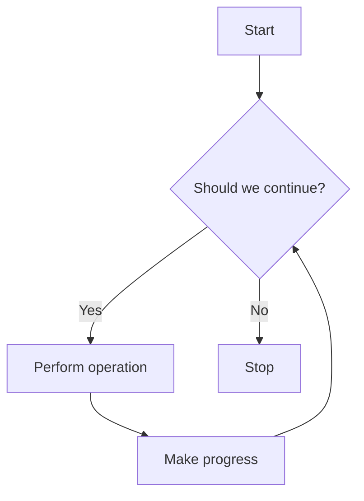
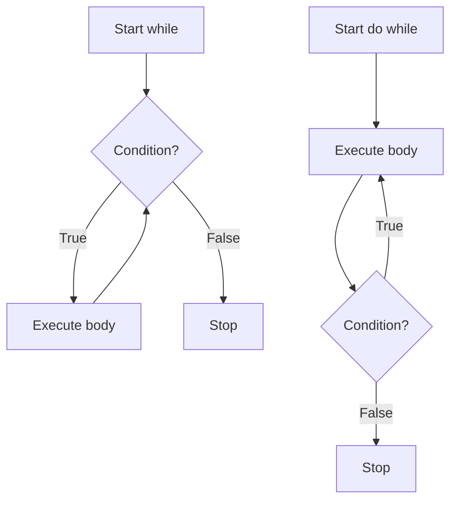
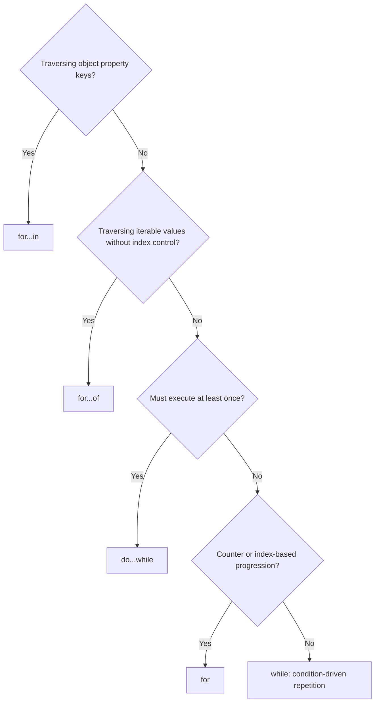

# JavaScript Loops — Understanding and Applying Them

## Table of contents

1. [Fundamentals of loops](#1-fundamentals-of-loops)
2. [for loop](#2-the-for-loop)
3. [while loop](#3-the-while-loop)
4. [do...while loop](#4-the-dowhile-loop)
5. [for...of loop](#5-the-forof-loop)
6. [for...in loop](#6-the-forin-loop)
7. [Comparing loops](#7-comparing-all-five-loops)
8. [Loop control statements](#8-loop-control-statements)
9. [Practice exercises, answers and explanations](#9-practice-exercises-with-answers-and-explanations)

We will learn these five loops together, focusing on their mental models, execution flow, expression decomposition, practical applications and how to choose the appropriate loop when solving a problem.

# 1. Fundamentals of loops

A loop is a programming structure that allows you to execute a block of code repeatedly without manually writing the same instructions multiple times.

## 1.1 Why loops exist

Suppose you want to print numbers from 1 to 5.

Without a loop:

```js
console.log(1);
console.log(2);
console.log(3);
console.log(4);
console.log(5);
```

With a loop:

```js
for (let i = 1; i <= 5; i++) {
  console.log(i);
}
```

Both produce:

```text
1
2
3
4
5
```

The loop allows us to express a repeated operation as a general instruction.

## 1.2 Mental model of a loop

Think of a loop as a system that performs an operation repeatedly while managing when to continue and when to stop.



Most condition-controlled loops have four fundamental components:

| Component | Purpose |
|---|---|
| Initialization | Establish the starting state |
| Condition | Determine whether to continue |
| Body | Perform the repeated operation |
| Update | Make progress towards termination |

An **iteration** is one execution of the loop body.

# 2. The `for` loop

## 2.1 Concept and mental model

A `for` loop is particularly useful when you know how to control the progression of a repetition.

For example, counting numbers, traversing array indexes, generating patterns and repeating an operation a specific number of times.

**Mental model:** Start somewhere, continue while a condition is true, and update after every iteration.

## 2.2 Syntax

```js
for (initialization; condition; update) {
  // Repeated operation
}
```

## 2.3 Basic example

Print numbers from 1 to 5.

```js
for (let i = 1; i <= 5; i++) {
  console.log(i);
}
```

### Code breakdown

**`let i = 1` — Initialization**

- `let` declares a variable.
- `i` is the variable name, commonly used as a counter or index.
- `= 1` assigns its starting value.

This executes only once.

**`i <= 5` — Condition**

- `i` represents the current counter value.
- `<=` means less than or equal to.
- `5` is the upper boundary.

The expression asks whether the current value of `i` is less than or equal to 5.

If true, execute the body. If false, terminate the loop.

**`console.log(i)` — Body**

Prints the current value of `i`.

**`i++` — Update**

Increases `i` by one.

In this context, it has the same effect as:

```js
i = i + 1;
```

## 2.4 Execution tracing

| i | Condition | Console output so far |
|---|---|---|
| 1 | true | 1 |
| 2 | true | 1 2 |
| 3 | true | 1 2 3 |
| 4 | true | 1 2 3 4 |
| 5 | true | 1 2 3 4 5 |
| 6 | false | 1 2 3 4 5 |

The condition is false at 6. The loop terminates without printing 6.

## 2.5 Traversing an array using a `for` loop

```js
const values = [12, 7, 4, 20];

for (let i = 0; i < values.length; i++) {
  console.log(values[i]);
}
```

Output:

```text
12
7
4
20
```

### Understanding array indexing

| Index | 0 | 1 | 2 | 3 |
|---|---|---|---|---|
| Value | 12 | 7 | 4 | 20 |
| Access | values[0] | values[1] | values[2] | values[3] |

Array length = 4. Last valid index = 3.

### Expression decomposition

**`values.length`**

Returns the number of elements in the array, which is 4.

**`i < values.length`**

Becomes:

```js
i < 4
```

This ensures that we only visit valid array indexes.

**`values[i]`**

Retrieves the element located at the current index.

When `i` is 2:

```js
values[i]
values[2]
4
```

**`console.log(values[i])`**

First retrieves the element at index `i`, then prints that element.

## 2.6 Different ways to control progression

| Loop header | Behaviour |
|---|---|
| `for (let i = 1; i <= 5; i++)` | Count forward |
| `for (let i = 5; i >= 1; i--)` | Count backward |
| `for (let i = 0; i <= 10; i += 2)` | Count in steps of two |
| `for (let i = 1; i <= 16; i *= 2)` | Double each time |

A `for` loop is not limited to increasing a counter by one. You control how the loop progresses.

---

# 3. The `while` loop

## 3.1 Concept and mental model

A `while` loop repeatedly executes a block of code as long as its condition remains true.

It is particularly useful when the number of iterations depends on a changing condition rather than a predetermined number.

**Mental model:** Keep performing an operation until a condition is no longer satisfied.

## 3.2 Syntax

```js
while (condition) {
  // Repeated operation
}
```

Unlike a `for` loop, initialization and updating are not built into the loop header.

## 3.3 Basic example

Print numbers from 1 to 5.

```js
let i = 1;

while (i <= 5) {
  console.log(i);
  i++;
}
```

### Code breakdown

| Expression | Explanation |
|---|---|
| `let i = 1` | Establish the starting value |
| `i <= 5` | Check whether to continue |
| `console.log(i)` | Print the current value |
| `i++` | Increase the counter by one |

The condition is checked before every iteration.

## 3.4 Comparing `for` and `while`

**For loop**

```js
for (let i = 1; i <= 5; i++) {
  console.log(i);
}
```

**While loop**

```js
let i = 1;
while (i <= 5) {
  console.log(i);
  i++;
}
```

Both produce exactly the same result. The difference is how initialization, condition and updating are organized.

## 3.5 Condition-driven repetition

### Problem

Given an array of numbers, print each number until you encounter `-1`.

Do not print `-1` or any numbers after it.

```js
const values = [12, 7, 4, -1, 20];

let index = 0;

while (
  index < values.length &&
  values[index] !== -1
) {
  console.log(values[index]);
  index++;
}
```

Output:

```text
12
7
4
```

### Expression decomposition

The condition contains two smaller conditions joined by `&&`.

```js
index < values.length && values[index] !== -1
```

**First condition:**

```js
index < values.length
```

Checks whether the current index is within the array's boundaries.

**Second condition:**

```js
values[index] !== -1
```

Breaking it down:

- `values[index]` retrieves the current element.
- `!==` means strictly not equal to.
- `-1` is the stopping value.

**Logical AND operator:** `&&`

Both conditions must be true for the loop body to execute. JavaScript checks the left condition first and only evaluates the right condition if the left one is true.

The complete condition means:

> Continue while there are elements remaining and the current element is not -1.

The value `-1` is called a **sentinel value** — a special value that signals termination.

## 3.6 Execution visualization

| index | index < 5 | values[index] | Not -1? | Output so far |
|---|---|---|---|---|
| 0 | true | 12 | true | 12 |
| 1 | true | 7 | true | 12 7 |
| 2 | true | 4 | true | 12 7 4 |
| 3 | true | -1 | false | 12 7 4 |

Sentinel encountered. Terminate the loop. The value 20 is never visited.

## 3.7 Repetition with an unknown number of iterations

### Problem

You have KSh 100. Double the amount repeatedly until it reaches or exceeds KSh 1,000.

```js
let money = 100;

while (money < 1000) {
  money *= 2;
}

console.log(money);
```

### Expression decomposition

`money *= 2;` is equivalent to:

```js
money = money * 2;
```

It retrieves the current amount, multiplies it by two and stores the result back into `money`.

| Iteration | Before | After |
|---|---:|---:|
| 1 | 100 | 200 |
| 2 | 200 | 400 |
| 3 | 400 | 800 |
| 4 | 800 | 1600 |

The loop stops because `1600 < 1000` is false.

Output: `1600`

We did not need to calculate the number of iterations beforehand.

---

# 4. The `do...while` loop

## 4.1 Concept and mental model

A `do...while` loop executes its body first and checks the condition afterward.

This guarantees that the body executes **at least once**, even if the condition is initially false.

**Mental model:** Perform an operation first, then decide whether to repeat it.

## 4.2 Syntax

```js
do {
  // Repeated operation
} while (condition);
```

Notice the semicolon after the condition.

## 4.3 Execution flow



While checks before execution. Do...while checks after execution.

## 4.4 Basic example

```js
let i = 1;

do {
  console.log(i);
  i++;
} while (i <= 5);
```

Output:

```text
1
2
3
4
5
```

### Execution order

1. Initialize `i` to 1.
2. Print the current value.
3. Increment `i`.
4. Check whether `i <= 5`.
5. Repeat if true; otherwise stop.

## 4.5 Understanding the fundamental difference

Consider an initially false condition.

**While loop**

```js
let i = 10;
while (i < 5) {
  console.log(i);
  i++;
}
```

Output: No output.

**Do...while loop**

```js
let i = 10;
do {
  console.log(i);
  i++;
} while (i < 5);
```

Output: `10`

The `while` loop never executes because its condition is initially false.

The `do...while` loop prints 10 before checking the condition.

## 4.6 Practical application: input validation

### Problem

Ask the user to enter a positive number. Continue asking until a valid number is entered.

```js
let number;

do {
  number = Number(prompt("Enter a positive number"));
} while (!Number.isFinite(number) || number <= 0);

console.log(number);
```

### Code and expression breakdown

**`let number;`** declares a variable without assigning an initial value.

**`prompt("Enter a positive number")`** displays an input dialog in a browser and returns the entered text, or `null` if cancelled.

**`Number(...)`** converts the returned value into a number.

```js
Number("25"); // 25
Number("abc"); // NaN
```

**`!Number.isFinite(number)`** checks whether the entered value is not a finite number.

**`number <= 0`** checks whether the number is zero or negative.

**`||`** is the logical OR operator. The loop repeats if either condition is true.

The `do...while` loop is appropriate because the user must be asked for input at least once.

This example uses the browser's `prompt()` function, which is not normally available in Node.js. Cancelling also causes another prompt in this simplified example.

---

# 5. The `for...of` loop

## 5.1 Concept and mental model

A `for...of` loop retrieves values from an iterable one at a time.

An iterable is a structure whose values can be visited sequentially, such as an array, string, Set or Map.

**Mental model:** For each value in this collection, perform an operation.

Unlike a traditional `for` loop, you do not need to manually manage an index or a stopping condition.

## 5.2 Syntax

```js
for (const value of iterable) {
  // Perform an operation on value
}
```

## 5.3 Traversing an array

```js
const numbers = [12, 7, 4, 20];

for (const number of numbers) {
  console.log(number);
}
```

Output:

```text
12
7
4
20
```

### Code breakdown

**`const numbers = [12, 7, 4, 20]`** creates the array that will be traversed.

**`const number`** declares a variable that receives the current element during each iteration.

**`of numbers`** instructs JavaScript to retrieve successive values from the array.

**`console.log(number)`** prints the current element.

## 5.4 Execution visualization

| Iteration | number | Output so far |
|---|---|---|
| 1 | 12 | 12 |
| 2 | 7 | 12 7 |
| 3 | 4 | 12 7 4 |
| 4 | 20 | 12 7 4 20 |

JavaScript automatically handles retrieving the next value and stopping when no values remain.

## 5.5 Comparing `for` and `for...of`

**Traditional for**

```js
for (let i = 0; i < numbers.length; i++) {
  console.log(numbers[i]);
}
```

**For...of**

```js
for (const number of numbers) {
  console.log(number);
}
```

The traditional `for` loop retrieves indexes, which you then use to access values.

The `for...of` loop retrieves the values directly.

## 5.6 Accumulating values

### Problem

Calculate the sum of all numbers in an array.

```js
const numbers = [10, 20, 30, 40];

let total = 0;

for (const number of numbers) {
  total += number;
}

console.log(total);
```

### Expression decomposition

`total += number;` is equivalent to:

```js
total = total + number;
```

This expression retrieves the existing total, adds the current number and stores the new total.

| Current number | Previous total | New total |
|---:|---:|---:|
| 10 | 0 | 10 |
| 20 | 10 | 30 |
| 30 | 30 | 60 |
| 40 | 60 | 100 |

Output: `100`

This is known as the **accumulation pattern**.

The variable `total` is called an accumulator because it collects results across iterations.

## 5.7 Traversing strings

Strings are also iterable.

```js
const word = "HELLO";

for (const character of word) {
  console.log(character);
}
```

Output:

```text
H
E
L
L
O
```

During each iteration, `character` receives the next character in this string.

## 5.8 Accessing indexes and values together

Although `for...of` normally retrieves values directly, you can use the array's `entries()` method to retrieve indexes and values together.

```js
const fruits = ["Apple", "Mango", "Banana"];

for (const [index, fruit] of fruits.entries()) {
  console.log(index, fruit);
}
```

Output:

```text
0 Apple
1 Mango
2 Banana
```

**`fruits.entries()`** produces an iterator containing index-value pairs.

Conceptually:

```js
[0, "Apple"]
[1, "Mango"]
[2, "Banana"]
```

**`const [index, fruit]`** uses array destructuring to assign the first item to `index` and the second item to `fruit`.

---

# 6. The `for...in` loop

## 6.1 Concept and mental model

A `for...in` loop traverses the enumerable string property keys of an object, including inherited enumerable properties.

It is primarily useful when working with object properties.

**Mental model:** For each enumerable property name in this object, perform an operation.

## 6.2 Understanding objects

Consider the following object:

```js
const student = {
  name: "John",
  age: 21,
  course: "JavaScript"
};
```

| Property key | Property value |
|---|---|
| name | John |
| age | 21 |
| course | JavaScript |

An object stores information as key-value pairs.

## 6.3 Syntax

```js
for (const key in object) {
  // Perform an operation
}
```

## 6.4 Retrieving object keys

```js
const student = {
  name: "John",
  age: 21,
  course: "JavaScript"
};

for (const key in student) {
  console.log(key);
}
```

Output:

```text
name
age
course
```

Notice that the loop retrieves property names, not their associated values.

## 6.5 Retrieving object values

```js
for (const key in student) {
  console.log(student[key]);
}
```

Output:

```text
John
21
JavaScript
```

### Expression decomposition

```js
student[key]
```

- `student` is the object.
- `key` is the variable containing the current property name.
- `[key]` dynamically accesses the property represented by that variable.

During the first iteration:

```js
key = "name"
```

Therefore:

```js
student[key]
student["name"]
"John"
```

### Why not use `student.key`?

`student.key` looks for a property literally named `key`.

However, `student[key]` looks for the property whose name is stored inside the variable `key`.

This is called **dynamic property access**.

## 6.6 Retrieving keys and values together

```js
for (const key in student) {
  console.log(key, student[key]);
}
```

| Iteration | key | student[key] |
|---|---|---|
| 1 | name | John |
| 2 | age | 21 |
| 3 | course | JavaScript |

Output:

```text
name John
age 21
course JavaScript
```

## 6.7 Using `for...in` with arrays

Technically, you can use `for...in` with arrays.

```js
const fruits = ["Apple", "Mango", "Banana"];

for (const key in fruits) {
  console.log(key);
}
```

Output:

```text
0
1
2
```

However, these keys are strings, not numeric indexes.

The loop can also visit additional enumerable properties that are not array elements.

Generally, prefer `for...of` for array values and a traditional `for` loop when you need direct control over array indexes.

## 6.8 Traversing only an object's own properties

Because `for...in` can include inherited properties, you can use `Object.hasOwn()` to restrict traversal.

```js
for (const key in student) {
  if (Object.hasOwn(student, key)) {
    console.log(key, student[key]);
  }
}
```

`Object.hasOwn(student, key)` returns true if the property belongs directly to the `student` object.

---

# 7. Comparing all five loops

## 7.1 Mental models

| Loop | Mental model |
|---|---|
| `for` | Start, check, execute and update |
| `while` | Keep going while a condition is true |
| `do...while` | Execute first, then decide whether to repeat |
| `for...of` | Visit each value |
| `for...in` | Visit each enumerable property key |

## 7.2 Choosing the appropriate loop



A practical loop selection guide, not a strict rule.

## 7.3 Practical problem recognition

| Problem | Preferred loop |
|---|---|
| Print numbers from 1 to 100 | `for` |
| Traverse an array backward | `for` |
| Print every value in an array | `for...of` |
| Calculate the sum of array elements | `for...of` |
| Repeat until a balance reaches zero | `while` |
| Process values until a sentinel is encountered | `while` |
| Request input at least once | `do...while` |
| Repeat a menu until the user exits | `do...while` |
| Display object property names | `for...in` |
| Display object keys and values | `for...in` |

Multiple loops can solve the same problem. The objective is to choose the one that expresses the problem most naturally.

---

# 8. Loop control statements

Loop control statements allow you to modify the normal execution of a loop.

## 8.1 The `break` statement

Terminates the entire loop immediately.

```js
const numbers = [10, 20, -1, 30];

for (const number of numbers) {
  if (number === -1) {
    break;
  }

  console.log(number);
}
```

Output:

```text
10
20
```

### Code breakdown

`number === -1` checks whether the current number is strictly equal to the stopping value.

`break;` terminates the loop immediately when the condition is true.

Notice that this solves the sentinel problem we previously solved using `while`.

## 8.2 The `continue` statement

Skips the remaining instructions in the current iteration and proceeds to the next iteration.

```js
const numbers = [10, -5, 20, -3, 30];

for (const number of numbers) {
  if (number < 0) {
    continue;
  }

  console.log(number);
}
```

Output:

```text
10
20
30
```

### Code breakdown

`number < 0` checks whether the current number is negative.

`continue;` skips printing that number and proceeds to the next iteration.

## 8.3 `break` versus `continue`

Given `[10, 20, -1, 30, 40]`:

| Statement | Behaviour | Output |
|---|---|---|
| break | Stop when -1 is encountered | 10, 20 |
| continue | Skip -1 and keep going | 10, 20, 30, 40 |

## 8.4 Infinite loops

An infinite loop occurs when a loop never reaches its termination condition.

Incorrect:

```js
let i = 1;

while (i <= 5) {
  console.log(i);
}
```

The value of `i` never changes. Therefore, the condition remains true indefinitely.

Correct:

```js
let i = 1;

while (i <= 5) {
  console.log(i);
  i++;
}
```

When designing condition-controlled loops, always consider how the program will eventually reach its stopping condition.

---

# 9. Practice exercises with answers and explanations

Attempt each exercise before revealing its solution. For each exercise, choose between `for`, `while`, `do...while`, `for...of` and `for...in`.

## Exercise 1 — Counting backward (Fundamental)

Print all numbers from 10 down to 1 using the most appropriate loop.

**Hint:** You know the starting value, ending boundary and direction of progression.

### Solution — for

```js
for (let i = 10; i >= 1; i--) {
  console.log(i);
}
```

**Code and expression breakdown**

- `let i = 10`: Start the counter at 10.
- `i >= 1`: Continue while the counter is greater than or equal to 1.
- `i--`: Decrease the counter by one after each iteration.
- `console.log(i)`: Print the current counter.

**Expected output:** `10 9 8 7 6 5 4 3 2 1`

## Exercise 2 — Condition-controlled repetition (Fundamental)

Start with the number 3. Repeatedly multiply it by 2 until it reaches or exceeds 100. Print the final value.

**Hint:** The number of repetitions depends on the current value.

### Solution — while

```js
let number = 3;

while (number < 100) {
  number *= 2;
}

console.log(number);
```

**Code and expression breakdown**

- `let number = 3`: Establish the starting value.
- `number < 100`: Continue while the number has not reached 100.
- `number *= 2`: Multiply the current number by two and store the result.
- `console.log(number)`: Print the final value after termination.

**Expected output:** `192`

## Exercise 3 — Execute at least once (Fundamental)

Start with a counter of 10. Print the counter at least once, and repeat only while it is less than 5. Increment it after printing.

**Hint:** The condition is initially false, but the body must execute.

### Solution — do...while

```js
let count = 10;

do {
  console.log(count);
  count++;
} while (count < 5);
```

**Code and expression breakdown**

- `let count = 10`: Initialize the counter.
- `do`: Execute the body before checking the condition.
- `count++`: Increase the counter to 11.
- `count < 5`: The condition is false, so terminate.

**Expected output:** `10`

## Exercise 4 — Counting positive numbers (Application)

Given `[-2, 5, -1, 8, 0, 12]`, count how many elements are strictly positive.

**Hint:** You need the values, not their indexes. Use a counter to accumulate the result.

### Solution — for...of

```js
const numbers = [-2, 5, -1, 8, 0, 12];
let count = 0;

for (const number of numbers) {
  if (number > 0) {
    count++;
  }
}

console.log(count);
```

**Code and expression breakdown**

- `let count = 0`: Initialize the number of positive elements found.
- `const number of numbers`: Retrieve each array value sequentially.
- `number > 0`: Determine whether the current value is positive.
- `count++`: Increase the count only when the condition is true.

**Expected output:** `3`

## Exercise 5 — Object property accumulation (Application)

Given the object `{ math: 80, english: 70, science: 90 }`, calculate the sum of all subject marks.

**Hint:** Traverse the property keys and dynamically access their values.

### Solution — for...in

```js
const marks = {
  math: 80,
  english: 70,
  science: 90
};

let total = 0;

for (const subject in marks) {
  total += marks[subject];
}

console.log(total);
```

**Code and expression breakdown**

- `const subject in marks`: Retrieve each property name.
- `marks[subject]`: Retrieve the mark associated with the current subject.
- `total += marks[subject]`: Add the current mark to the accumulated total.

**Expected output:** `240`

## Exercise 6 — Sentinel-controlled accumulation (Application)

Given `[5, 10, 15, -1, 30]`, calculate the sum of all numbers before the first -1. Do not include -1 or subsequent values.

**Hint:** You have two stopping conditions: the end of the array and the sentinel.

### Solution — while

```js
const numbers = [5, 10, 15, -1, 30];
let index = 0;
let total = 0;

while (
  index < numbers.length &&
  numbers[index] !== -1
) {
  total += numbers[index];
  index++;
}

console.log(total);
```

**Code and expression breakdown**

- `index < numbers.length`: Ensure the current index is within the array.
- `numbers[index] !== -1`: Ensure the current value is not the sentinel.
- `total += numbers[index]`: Retrieve the current element and add it to the total.
- `index++`: Advance to the next element.

**Expected output:** `30`

## Exercise 7 — Reverse array traversal (Application)

Given `[10, 20, 30, 40]`, print its elements in reverse order without modifying the array.

**Hint:** Start at the last valid index and move backward.

### Solution — for

```js
const numbers = [10, 20, 30, 40];

for (let i = numbers.length - 1; i >= 0; i--) {
  console.log(numbers[i]);
}
```

**Code and expression breakdown**

- `numbers.length - 1`: Subtract one from the array length to obtain the last valid index, which is 3.
- `i >= 0`: Continue until the first element has been visited.
- `i--`: Move backward by one index.
- `numbers[i]`: Retrieve the element at the current index.

**Expected output:** `40 30 20 10`

---

# 10. Final mental model

The most important skill is not memorizing loop syntax. It is recognizing the nature of the repetition required by a problem.

| Ask yourself | Think of |
|---|---|
| How should I control progression? | `for` |
| What condition determines when to stop? | `while` |
| Must the operation happen at least once? | `do...while` |
| Do I need the individual values? | `for...of` |
| Do I need the object property names? | `for...in` |

Before writing any loop, identify the starting state, the repeated operation, how progress happens and the stopping condition. For `for...of` and `for...in`, JavaScript manages much of the traversal automatically.

**Learning progression**

- [x] Loop fundamentals
- [x] For loop
- [x] While loop
- [x] Do...while loop
- [x] For...of loop
- [x] For...in loop
- [x] Loop control statements
- [ ] Nested loops
- [ ] Loop problem-solving patterns
- [ ] Advanced loop applications

I have grouped all five loops into one lesson rather than teaching them separately, using detailed concept explanations, mental models, expression decomposition, execution tracing and exercises with explained answers. The lesson focuses on ordinary synchronous loops; nested loops and advanced iteration are reserved for subsequent lessons.

**Previous:** JavaScript fundamentals

**Next:** Nested loops and multidimensional traversal.
