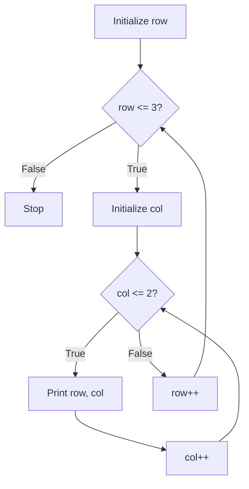

# JavaScript Nested Loops and Multidimensional Traversal

**Previous:** [JavaScript Loops — Fundamentals](javascript-loops-fundamentals.md)  
**Current:** Nested Loops and Multidimensional Traversal  
**Next:** Loop Problem-Solving Patterns

## Table of contents

1. [Understanding nested loops](#1-understanding-nested-loops)
2. [Outer and inner loops](#2-outer-and-inner-loops)
3. [Execution flow and tracing](#3-execution-flow-and-tracing)
4. [Independent and dependent nested loops](#4-independent-and-dependent-nested-loops)
5. [Generating rectangular patterns](#5-generating-rectangular-patterns)
6. [Generating triangular patterns](#6-generating-triangular-patterns)
7. [Traversing multidimensional arrays](#7-traversing-multidimensional-arrays)
8. [Accessing rows, columns and individual elements](#8-accessing-rows-columns-and-individual-elements)
9. [Combining elements and generating pairs](#9-combining-elements-and-generating-pairs)
10. [Using break and continue in nested loops](#10-using-break-and-continue-in-nested-loops)
11. [Counting iterations and common mistakes](#11-counting-iterations-and-common-mistakes)
12. [Practice exercises with answers and explanations](#12-practice-exercises-with-answers-and-explanations)
13. [Nested loop problem-solving mental model](#13-nested-loop-problem-solving-mental-model)
14. [Final concept summary](#14-final-concept-summary)

---

# 1. Understanding nested loops

## 1.1 What is a nested loop?

A nested loop is a loop placed inside another loop.

A normal loop controls repetition along one dimension. A nested loop allows you to perform another repetition during each iteration of the first loop.

Consider a classroom containing three rows of desks, with four desks in each row.

| Rows | Column 1 | Column 2 | Column 3 | Column 4 |
|---|---|---|---|---|
| Row 1 | (1,1) | (1,2) | (1,3) | (1,4) |
| Row 2 | (2,1) | (2,2) | (2,3) | (2,4) |
| Row 3 | (3,1) | (3,2) | (3,3) | (3,4) |

3 rows × 4 desks = 12 desks.

To visit every desk, you need to:

- Select a row.
- Visit every desk in that row.
- Move to the next row.
- Repeat until all rows have been visited.

This is the fundamental idea behind nested loops.

## 1.2 Mental model

**For every iteration of the outer loop, perform the inner loop from beginning to end**, unless a control statement interrupts it.

Think of it as repetition within repetition.

## 1.3 When nested loops are useful

Nested loops are commonly used when working with grids, tables, patterns, multidimensional arrays, combinations, pairs of elements and comparisons between collections.

---

# 2. Outer and inner loops

## 2.1 Basic syntax

```js
for (initialization; condition; update) {
  for (initialization; condition; update) {
    // Repeated operation
  }
}
```

The first loop is called the **outer loop**. The loop inside it is called the **inner loop**.

## 2.2 Basic example

Print every combination of three rows and two columns.

```js
for (let row = 1; row <= 3; row++) {
  for (let col = 1; col <= 2; col++) {
    console.log(row, col);
  }
}
```

Output:

```text
1 1
1 2
2 1
2 2
3 1
3 2
```

## 2.3 Code and expression breakdown

### Outer loop

```js
for (let row = 1; row <= 3; row++)
```

| Expression | Meaning |
|---|---|
| `let row = 1` | Start at row 1 |
| `row <= 3` | Continue while the row is within the boundary |
| `row++` | Move to the next row |

The outer loop controls which row is currently being processed.

### Inner loop

```js
for (let col = 1; col <= 2; col++)
```

| Expression | Meaning |
|---|---|
| `let col = 1` | Start at column 1 |
| `col <= 2` | Continue while the column is within the boundary |
| `col++` | Move to the next column |

The inner loop controls which column is currently being processed.

### Loop body

```js
console.log(row, col);
```

Prints the current value of the outer loop variable, `row`, and the current value of the inner loop variable, `col`.

The outer variable remains unchanged while the inner loop completes its iterations.

## 2.4 Why does the inner loop restart?

`let col = 1` belongs to the inner loop. Whenever the outer loop enters its body again, it encounters the inner loop as a new execution. Therefore, `col` starts at 1 again. The outer loop does not restart when the inner loop advances.

---

# 3. Execution flow and tracing

## 3.1 Step-by-step execution

Print the current pair and advance the inner variable. The outer variable remains unchanged. When the inner loop finishes, the outer variable advances, and the inner loop restarts if the outer condition is still true. When the outer condition becomes false, both loops have finished.

## 3.2 Execution trace table

| Iteration | `row` | `col` | Output |
|---:|---:|---:|---|
| 1 | 1 | 1 | 1 1 |
| 2 | 1 | 2 | 1 2 |
| 3 | 2 | 1 | 2 1 |
| 4 | 2 | 2 | 2 2 |
| 5 | 3 | 1 | 3 1 |
| 6 | 3 | 2 | 3 2 |

## 3.3 Execution order



The inner loop finishes before the outer loop advances.

---

# 4. Independent and dependent nested loops

The relationship between the outer and inner loops determines the structure of the repetition.

## 4.1 Independent nested loops

An independent inner loop has a boundary that does not depend on the outer loop variable.

```js
for (let row = 1; row <= 3; row++) {
  for (let col = 1; col <= 4; col++) {
    console.log(row, col);
  }
}
```

The inner condition is `col <= 4`. Regardless of the current row, the inner loop performs four iterations.

```text
1 2 3 4
1 2 3 4
1 2 3 4
```

Total iterations: 4 + 4 + 4 = 12.

**Mental model:** For every outer iteration, perform a fixed number of inner iterations.

## 4.2 Dependent nested loops

A dependent inner loop uses the outer variable to determine its starting point, ending point or progression.

```js
for (let row = 1; row <= 4; row++) {
  for (let col = 1; col <= row; col++) {
    console.log(row, col);
  }
}
```

### Expression decomposition

`col <= row` compares `col` with the current value of `row` instead of a fixed number. When `row` is 3, the condition becomes `col <= 3`. Therefore, the inner loop performs three iterations.

```text
1
1 2
1 2 3
1 2 3 4
```

Total iterations: 1 + 2 + 3 + 4 = 10.

**Mental model:** The outer loop determines how much work the inner loop performs.

## 4.3 Comparing the two

| Feature | Independent | Dependent |
|---|---|---|
| Inner boundary | Fixed or independent | Depends on outer variable |
| Inner iterations | Often constant | Often changes |
| Common application | Rectangular grids | Triangles and combinations |

---

# 5. Generating rectangular patterns

## 5.1 Understanding pattern generation

A pattern is an arrangement of elements according to a particular rule. The outer loop controls the rows; the inner loop controls the contents of each row.

## 5.2 Problem: Generate a rectangle of stars

Write a program that generates three rows containing five stars each.

```text
*****
*****
*****
```

| Component | Requirement |
|---|---|
| Number of rows | 3 |
| Elements per row | 5 |
| Element | `*` |
| Outer loop | Generate rows |
| Inner loop | Build each row |

```js
for (let row = 1; row <= 3; row++) {
  let line = "";
  for (let col = 1; col <= 5; col++) {
    line += "*";
  }
  console.log(line);
}
```

## 5.3 Detailed code breakdown

`let line = "";` creates an empty string that will store the stars belonging to the current row. The variable is declared inside the outer loop but outside the inner loop. This placement ensures that every new row starts with an empty string.

`line += "*";` is equivalent to `line = line + "*";`.

1. Retrieve the current value of `line`.
2. Concatenate a star to the existing string.
3. Store the resulting string back into `line`.

If `line` currently contains `"**"`, then `line = "**" + "*"` produces `"***"`. This operation is called **string accumulation**.

## 5.4 Visualizing string accumulation

| Iteration | Current line |
|---|---|
| 0 | `""` |
| 1 | `"*"` |
| 2 | `"**"` |
| 3 | `"***"` |
| 4 | `"****"` |
| 5 | `"*****"` |

## 5.5 Why is console.log(line) outside the inner loop?

The inner loop must finish building the row before it is printed. If you place `console.log(line)` inside the inner loop:

```js
for (let col = 1; col <= 5; col++) {
  line += "*";
  console.log(line);
}
```

The output for each row becomes:

```text
*
**
***
****
*****
```

**Principle:** The placement of an operation determines how frequently it executes.

## 5.6 Why reset the accumulator inside the outer loop?

Incorrect:

```js
let line = "";
for (let row = 1; row <= 3; row++) {
  for (let col = 1; col <= 5; col++) {
    line += "*";
  }
  console.log(line);
}
```

```text
*****
**********
***************
```

Because `line` is initialized outside both loops, it retains the stars from previous rows.

Correct:

```js
for (let row = 1; row <= 3; row++) {
  let line = "";
  for (let col = 1; col <= 5; col++) {
    line += "*";
  }
  console.log(line);
}
```

**Mental model:** Initialize an accumulator at the level where you want its accumulation to begin again.

---

# 6. Generating triangular patterns

## 6.1 Increasing triangle

```text
*
**
***
****
*****
```

The number of stars equals the current row number. Therefore, the inner loop must depend on the outer loop.

```js
for (let row = 1; row <= 5; row++) {
  let line = "";
  for (let col = 1; col <= row; col++) {
    line += "*";
  }
  console.log(line);
}
```

`col <= row` determines the number of stars generated for the current row. When `row = 4`, the inner loop runs four times, producing `"****"`.

## 6.2 Decreasing triangle

```text
*****
****
***
**
*
```

```js
for (let row = 5; row >= 1; row--) {
  let line = "";
  for (let col = 1; col <= row; col++) {
    line += "*";
  }
  console.log(line);
}
```

`let row = 5` starts the outer variable at 5. `row >= 1` continues while at least one star should be generated. `row--` decreases the outer variable by one after each completed row. The inner loop still uses `col <= row`, but row decreases rather than increases.

## 6.3 Generating patterns using mathematical relationships

```js
const size = 5;
for (let row = 1; row <= size; row++) {
  let line = "";
  for (let col = 1; col <= size - row + 1; col++) {
    line += "*";
  }
  console.log(line);
}
```

`size - row + 1` calculates how many stars are required for the current row. When `row = 2`, `5 - 2 + 1` becomes `3 + 1`, then `4`.

| size | row | size - row + 1 |
|---:|---:|---:|
| 5 | 1 | 5 |
| 5 | 2 | 4 |
| 5 | 3 | 3 |
| 5 | 4 | 2 |
| 5 | 5 | 1 |

The `+ 1` ensures that the first row contains five stars and the last row contains one.

## 6.4 Pattern explorer (static reference)

| Pattern | Inner boundary | Stars for size 5 |
|---|---|---:|
| Rectangle | `col <= size` | 25 |
| Increasing triangle | `col <= row` | 15 |
| Decreasing triangle | `col <= size - row + 1` | 15 |
| Right-aligned triangle | `star <= row` | 15 |

## 6.5 Generating a right-aligned triangle

```text
    *
   **
  ***
 ****
*****
```

| Row | Spaces | Stars |
|---:|---:|---:|
| 1 | 4 | 1 |
| 2 | 3 | 2 |
| 3 | 2 | 3 |
| 4 | 1 | 4 |
| 5 | 0 | 5 |

```js
const size = 5;
for (let row = 1; row <= size; row++) {
  let line = "";
  // Generate spaces
  for (let space = 1; space <= size - row; space++) {
    line += " ";
  }
  // Generate stars
  for (let star = 1; star <= row; star++) {
    line += "*";
  }
  console.log(line);
}
```

`size - row` calculates the number of leading spaces. When row is 2, `5 - 2` produces three spaces. `star <= row` determines the number of stars. `line += " "` appends one space; `line += "*"` appends one star. The two inner loops are sequential, not nested inside each other.

**Mental model:** Build each row in stages.

---

# 7. Traversing multidimensional arrays

## 7.1 Understanding multidimensional arrays

A multidimensional array is an array containing other arrays.

```js
const numbers = [10, 20, 30];
const matrix = [
  [10, 20, 30],
  [40, 50, 60],
  [70, 80, 90]
];
```

| Indexes | Column 0 | Column 1 | Column 2 |
|---|---|---|---|
| Row 0 | 10 [0][0] | 20 [0][1] | 30 [0][2] |
| Row 1 | 40 [1][0] | 50 [1][1] | 60 [1][2] |
| Row 2 | 70 [2][0] | 80 [2][1] | 90 [2][2] |

JavaScript represents this structure as an array of arrays rather than a special matrix data type.

## 7.2 Understanding the outer array

`matrix[0]` retrieves `[10, 20, 30]`. Similarly, `matrix[1]` returns `[40, 50, 60]`.

## 7.3 Understanding array length

`matrix.length` returns 3 because the outer array contains three elements. `matrix[0].length` first retrieves `[10, 20, 30]` and then retrieves its length, 3. The outer length represents the number of rows. The inner length represents the number of elements in a particular row.

---

# 8. Accessing rows, columns and individual elements

## 8.1 Accessing an individual element

`matrix[1][2]` performs two separate indexing operations. First `matrix[1]` returns `[40, 50, 60]`. Then `[40, 50, 60][2]` returns `60`.

## 8.2 Array indexing visualization

| Expression | Selected row | Result |
|---|---|---:|
| `matrix[0][1]` | `[10, 20, 30]` | 20 |
| `matrix[1][2]` | `[40, 50, 60]` | 60 |
| `matrix[2][0]` | `[70, 80, 90]` | 70 |

**Mental model:** Select the inner array first, then select an element from that inner array.

## 8.3 Traversing a two-dimensional array using for

Print every number in the matrix.

```js
const matrix = [
  [10, 20, 30],
  [40, 50, 60],
  [70, 80, 90]
];
for (let row = 0; row < matrix.length; row++) {
  for (let col = 0; col < matrix[row].length; col++) {
    console.log(matrix[row][col]);
  }
}
```

### Detailed expression decomposition

- `row < matrix.length` checks whether the current row index is within the outer array's boundaries. It becomes `row < 3`.
- `matrix[row]` retrieves the inner array at the current row index. When row is 1, it returns `[40, 50, 60]`.
- `matrix[row].length` retrieves the length of the current inner array.
- `col < matrix[row].length` ensures that the column index is within the boundaries of the current row.
- `matrix[row][col]` retrieves the element at the intersection of the current row and column indexes. When row is 1 and col is 2, `matrix[1][2]` gives 60.

## 8.4 Traversing using for...of

```js
for (const row of matrix) {
  for (const number of row) {
    console.log(number);
  }
}
```

`const row of matrix` retrieves each inner array from the outer array. During the first outer iteration, row is `[10, 20, 30]`. `const number of row` retrieves each number from that particular inner array.

| Traditional for | for...of |
|---|---|
| Retrieves indexes | Retrieves values |
| Requires manual indexing | Directly accesses elements |
| Provides index control | Simpler value traversal |
| Useful for modifying indexed elements | Useful for reading and processing values |

## 8.5 Traversing irregular arrays

```js
const numbers = [
  [10, 20],
  [30, 40, 50],
  [60]
];
for (let row = 0; row < numbers.length; row++) {
  for (let col = 0; col < numbers[row].length; col++) {
    console.log(numbers[row][col]);
  }
}
```

An irregular array is also called a jagged array. `numbers[row].length` dynamically determines the length of the current row rather than assuming every row has the same length.

## 8.6 Row-wise and column-wise traversal

```js
const matrix = [
  [1, 2, 3],
  [4, 5, 6],
  [7, 8, 9]
];
```

### Row-wise traversal

```js
for (let row = 0; row < matrix.length; row++) {
  for (let col = 0; col < matrix[row].length; col++) {
    console.log(matrix[row][col]);
  }
}
```

Output: `1 2 3 4 5 6 7 8 9`

### Column-wise traversal

```js
for (let col = 0; col < matrix[0].length; col++) {
  for (let row = 0; row < matrix.length; row++) {
    console.log(matrix[row][col]);
  }
}
```

Output: `1 4 7 2 5 8 3 6 9`

The outer loop now controls columns, while the inner loop controls rows. This column-wise solution assumes a nonempty rectangular matrix.

**Mental model:** The outer loop determines the primary direction of traversal.

---

# 9. Combining elements and generating pairs

## 9.1 Combining two collections

Given two shirt colors and three trouser colors, generate every possible outfit combination.

```js
const shirts = ["White", "Black"];
const trousers = ["Blue", "Grey", "Brown"];
for (const shirt of shirts) {
  for (const trouser of trousers) {
    console.log(shirt, trouser);
  }
}
```

```text
White Blue
White Grey
White Brown
Black Blue
Black Grey
Black Brown
```

**Mental model:** For every element in the first collection, visit every element in the second collection. This operation is known as a **Cartesian product**. 2 × 3 = 6 combinations.

## 9.2 Generating unique pairs from one array

Generate every unique pair of positions without pairing an element with itself or repeating a pair in reverse order.

```js
const numbers = [10, 20, 30, 40];
for (let i = 0; i < numbers.length; i++) {
  for (let j = i + 1; j < numbers.length; j++) {
    console.log(numbers[i], numbers[j]);
  }
}
```

```text
10 20
10 30
10 40
20 30
20 40
30 40
```

`let j = i + 1` determines where the inner loop begins. When i is 0, j is 1. When i is 1, j is 2. The inner loop starts immediately after the outer element, preventing revisiting earlier positions.

| i / j | 10 | 20 | 30 | 40 |
|---|---|---|---|---|
| 10 | — | ✓ | ✓ | ✓ |
| 20 | × | — | ✓ | ✓ |
| 30 | × | × | — | ✓ |
| 40 | × | × | × | — |

This prevents duplicate index pairs. If the array contains duplicate values, identical value pairs may still appear.

## 9.3 Finding pairs that satisfy a condition

Find all pairs of numbers whose sum is 50.

```js
const numbers = [10, 20, 30, 40];
for (let i = 0; i < numbers.length; i++) {
  for (let j = i + 1; j < numbers.length; j++) {
    if (numbers[i] + numbers[j] === 50) {
      console.log(numbers[i], numbers[j]);
    }
  }
}
```

Expression decomposition for i = 0 and j = 3:

```js
numbers[i] + numbers[j] === 50
numbers[0] + numbers[3] === 50
10 + 40 === 50
50 === 50
true
```

```text
10 40
20 30
```

**Mental model:** Generate candidate pairs, evaluate each pair against a condition, and process only matching pairs.

---

# 10. Using break and continue in nested loops

## 10.1 Using break

A normal `break` statement terminates the nearest enclosing loop.

```js
for (let row = 1; row <= 3; row++) {
  for (let col = 1; col <= 4; col++) {
    if (col === 3) {
      break;
    }
    console.log(row, col);
  }
}
```

```text
1 1
1 2
2 1
2 2
3 1
3 2
```

When col reaches 3, the inner loop terminates. The outer loop continues to its next iteration.

## 10.2 Using continue

A normal `continue` statement skips the remaining operations in the current iteration of the nearest enclosing loop.

```js
for (let row = 1; row <= 3; row++) {
  for (let col = 1; col <= 4; col++) {
    if (col === 3) {
      continue;
    }
    console.log(row, col);
  }
}
```

```text
1 1
1 2
1 4
2 1
2 2
2 4
3 1
3 2
3 4
```

| Statement | Columns printed per row |
|---|---|
| break | 1, 2 |
| continue | 1, 2, 4 |

Both statements affect the inner loop. The outer loop continues.

## 10.3 Breaking out of both loops

Search a matrix for the number 50. Stop searching completely when it is found.

```js
const matrix = [
  [10, 20, 30],
  [40, 50, 60],
  [70, 80, 90]
];
search:
for (let row = 0; row < matrix.length; row++) {
  for (let col = 0; col < matrix[row].length; col++) {
    if (matrix[row][col] === 50) {
      console.log("Found:", row, col);
      break search;
    }
  }
}
```

Output: `Found: 1 1`

`search:` defines a label named search for the outer loop. `break search;` terminates the labeled outer loop, including the inner loop currently executing within it. Without the label, break would terminate only the inner loop. Returning from a function can often provide a cleaner alternative.

---

# 11. Counting iterations and common mistakes

## 11.1 Counting independent iterations

```js
for (let i = 1; i <= 4; i++) {
  for (let j = 1; j <= 3; j++) {
    console.log(i, j);
  }
}
```

The outer loop executes four times. The inner loop executes three times per outer iteration. Total inner body executions: 4 × 3 = 12.

## 11.2 Counting dependent iterations

```js
for (let i = 1; i <= 4; i++) {
  for (let j = 1; j <= i; j++) {
    console.log(i, j);
  }
}
```

Total: 1 + 2 + 3 + 4 = 10. For an increasing triangle of size n: `n * (n + 1) / 2`. For unique index pairs from an array of length n: `n * (n - 1) / 2`.

## 11.3 Iteration calculator (static reference)

| Pattern | Formula | n = 5, m = 4 |
|---|---|---:|
| Independent loops | n × m | 20 |
| Increasing triangle | n × (n + 1) / 2 | 15 |
| Unique pairs | n × (n - 1) / 2 | 10 |

## 11.4 Understanding performance

When both independent loops perform n iterations, the total number of inner operations is n × n = n².

| Collection size | Single loop | Two full nested loops |
|---:|---:|---:|
| 10 | 10 | 100 |
| 20 | 20 | 400 |
| 30 | 30 | 900 |
| 40 | 40 | 1600 |
| 50 | 50 | 2500 |

Nested loops can become expensive when processing large collections. However, not every nested loop has quadratic complexity. The actual complexity depends on how the loops progress and how many operations they perform.

## 11.5 Common mistakes

| Mistake | Consequence |
|---|---|
| Using the outer variable in the wrong update expression | Incorrect progression or nontermination |
| Using `<= array.length` | Accessing an invalid array index |
| Initializing an accumulator at the wrong level | Unwanted accumulation across rows |
| Printing inside the wrong loop | Incorrect or excessive output |
| Assuming every inner array has equal length | Missing elements or accessing invalid positions |
| Assuming break terminates both loops | Outer loop continues unexpectedly |

Incorrect:

```js
for (let i = 0; i < 3; i++) {
  for (let j = 0; j < 3; i++) {
    console.log(i, j);
  }
}
```

The inner loop updates i instead of j. Because j remains zero, its condition remains true.

Correct:

```js
for (let i = 0; i < 3; i++) {
  for (let j = 0; j < 3; j++) {
    console.log(i, j);
  }
}
```

Always identify which variable controls each loop and how that variable progresses.

---

# 12. Practice exercises with answers and explanations

Attempt each problem independently before reading the solution.

## Exercise 1 — Generate a rectangular number pattern

Write a program that generates four rows. Each row should contain the numbers 1 through 5.

```text
12345
12345
12345
12345
```

**Hint:** The outer loop controls four rows. The inner loop generates numbers 1 through 5.

```js
for (let row = 1; row <= 4; row++) {
  let line = "";
  for (let col = 1; col <= 5; col++) {
    line += col;
  }
  console.log(line);
}
```

- `row <= 4`: Generate exactly four rows.
- `let line = ""`: Reset the string for each new row.
- `col <= 5`: Generate five numbers per row.
- `line += col`: Because line is a string, JavaScript converts col to a string and concatenates it.
- `console.log(line)`: Print the completed row.

## Exercise 2 — Generate an increasing number triangle

Generate five rows such that each row contains the numbers from 1 up to its row number.

```text
1
12
123
1234
12345
```

**Hint:** The inner boundary depends on the outer variable.

```js
for (let row = 1; row <= 5; row++) {
  let line = "";
  for (let col = 1; col <= row; col++) {
    line += col;
  }
  console.log(line);
}
```

- `row <= 5`: Controls the total number of rows.
- `col <= row`: When row is 3, generate the numbers 1, 2 and 3.
- `line += col`: Append the current column number to the string.
- `console.log(line)`: Print the completed number sequence.

## Exercise 3 — Generate a repeated row-number pattern

Generate five rows. Each row should contain its own row number repeated as many times as that row number.

```text
1
22
333
4444
55555
```

**Hint:** The inner loop controls how many times to append. The outer variable determines what to append.

```js
for (let row = 1; row <= 5; row++) {
  let line = "";
  for (let col = 1; col <= row; col++) {
    line += row;
  }
  console.log(line);
}
```

- `col <= row`: Determine how many repetitions are required.
- `line += row`: Append the outer variable rather than the inner variable. For row 3, append 3 three times.
- `let line = ""`: Prevent previous rows from affecting the current row.

## Exercise 4 — Calculate the sum of a two-dimensional array

Given `[[10, 20], [30, 40, 50], [60]]`, calculate the sum of all numbers. Expected output: `210`.

**Hint:** Use nested for...of loops and one accumulator shared by all rows.

```js
const matrix = [[10, 20], [30, 40, 50], [60]];
let total = 0;
for (const row of matrix) {
  for (const number of row) {
    total += number;
  }
}
console.log(total);
```

- `let total = 0`: Initialize outside both loops because the total must include every row.
- `const row of matrix`: Retrieve each inner array.
- `const number of row`: Retrieve each number in the current inner array.
- `total += number`: Equivalent to total = total + number. Accumulate each value.
- `console.log(total)`: Print the result after all rows have been processed.

## Exercise 5 — Calculate the sum of each row

Given `[[10, 20], [30, 40, 50], [60]]`, print the sum of each row separately.

```text
30
120
60
```

**Hint:** Unlike the previous exercise, reset the accumulator for each row.

```js
const matrix = [[10, 20], [30, 40, 50], [60]];
for (const row of matrix) {
  let total = 0;
  for (const number of row) {
    total += number;
  }
  console.log(total);
}
```

- `let total = 0`: Initialize inside the outer loop so every row starts with a fresh total.
- `total += number`: Accumulate only the values belonging to the current row.
- `console.log(total)`: Print after the inner loop finishes but before moving to the next row.

## Exercise 6 — Find the largest element

Given `[[-10, -5], [-20, -2], [-15]]`, find the largest number. Expected output: `-2`.

**Hint:** Initialize the maximum using the first actual element rather than zero.

```js
const matrix = [[-10, -5], [-20, -2], [-15]];
let largest = matrix[0][0];
for (const row of matrix) {
  for (const number of row) {
    if (number > largest) {
      largest = number;
    }
  }
}
console.log(largest);
```

- `matrix[0][0]`: Retrieve the first element of the first row, which is -10.
- `number > largest`: Check whether the current element exceeds the largest value found so far.
- `largest = number`: Replace the stored maximum whenever a larger number is encountered.
- Initialization: Using zero would produce an incorrect result because every number is negative. This solution assumes the first row contains an element.

## Exercise 7 — Generate a multiplication table

Generate multiplication expressions for every combination of numbers from 1 to 3.

```text
1 x 1 = 1
1 x 2 = 2
1 x 3 = 3
2 x 1 = 2
2 x 2 = 4
2 x 3 = 6
3 x 1 = 3
3 x 2 = 6
3 x 3 = 9
```

**Hint:** Use independent nested loops and multiply the two current loop variables.

```js
for (let i = 1; i <= 3; i++) {
  for (let j = 1; j <= 3; j++) {
    console.log(`${i} x ${j} = ${i * j}`);
  }
}
```

- `i <= 3`: Select each first factor.
- `j <= 3`: Select each second factor.
- `i * j`: Multiply the current outer and inner values.
- Template literal: Backticks create a string, and `${...}` inserts evaluated expressions into it.

## Exercise 8 — Find matching pairs

Given `[2, 4, 6, 8, 10]`, print every unique index pair whose sum equals 12.

```text
2 10
4 8
```

**Hint:** Start the inner index immediately after the outer index.

```js
const numbers = [2, 4, 6, 8, 10];
for (let i = 0; i < numbers.length; i++) {
  for (let j = i + 1; j < numbers.length; j++) {
    if (numbers[i] + numbers[j] === 12) {
      console.log(numbers[i], numbers[j]);
    }
  }
}
```

- `j = i + 1`: Visit only elements after the current outer element, preventing self-pairing and reversed index pairs.
- `numbers[i]`: Retrieve the first candidate value.
- `numbers[j]`: Retrieve the second candidate value.
- `numbers[i] + numbers[j] === 12`: Add the candidate values and test whether their sum equals the target.
- `console.log(numbers[i], numbers[j])`: Print only matching pairs.

## Exercise 9 — Find the position of an element

Given `[[10, 20], [30, 40], [50, 60]]`, find the row and column indexes of 40 and stop searching immediately. Expected output: `1 1`.

**Hint:** Use indexed loops because the required result is a position. Consider a labeled break.

```js
const matrix = [[10, 20], [30, 40], [50, 60]];
search:
for (let row = 0; row < matrix.length; row++) {
  for (let col = 0; col < matrix[row].length; col++) {
    if (matrix[row][col] === 40) {
      console.log(row, col);
      break search;
    }
  }
}
```

- `matrix[row].length`: Determine the length of the current row.
- `matrix[row][col] === 40`: Retrieve the current element and compare it with the target.
- `console.log(row, col)`: Print the indexes rather than the element itself.
- `break search`: Terminate the labeled outer loop and the inner loop together.

---

# 13. Nested loop problem-solving mental model

| Question | What it determines |
|---|---|
| What is the primary repetition? | Outer loop |
| What repeats during each primary iteration? | Inner loop |
| Where does each loop start? | Initialization |
| When should each loop stop? | Condition |
| How does each loop progress? | Update |
| Does the inner loop depend on the outer loop? | Relationship between loops |
| What needs to be accumulated? | Accumulator |
| When should accumulation reset? | Variable placement |
| When should the result be processed? | Operation placement |

## 13.1 Understanding operation placement

```js
// Level 1: Execute once
for (let i = 0; i < 3; i++) {
  // Level 2: Execute once per outer iteration
  for (let j = 0; j < 4; j++) {
    // Level 3: Execute once per inner iteration
  }
  // Level 2: Execute after each inner loop finishes
}
// Level 1: Execute after both loops finish
```

| Level | Frequency |
|---|---|
| Outside both loops | Once |
| Outer loop body | 3 times |
| Inner loop body | 12 times |

Understanding these execution levels is essential for solving nested loop problems.

# 14. Final concept summary

| Concept | Mental model |
|---|---|
| Nested loop | Repetition within repetition |
| Outer loop | Select the primary item or group |
| Inner loop | Process items within the current group |
| Independent loops | Repeat a fixed or independently determined amount of work |
| Dependent loops | Let the outer variable determine inner repetition |
| Pattern generation | Build each row element by element |
| Multidimensional traversal | Select an array, then select its elements |
| Unique pairs | Compare each element with subsequent elements |
| Accumulator placement | Determine when stored results reset |
| Operation placement | Determine how frequently an operation executes |
| Labeled break | Terminate a specified enclosing loop |

## Learning progression

- [x] Loop fundamentals
- [x] For, while and do...while
- [x] For...of and for...in
- [x] Loop control statements
- [x] Nested loop execution
- [x] Independent and dependent loops
- [x] Pattern generation
- [x] Multidimensional traversal
- [x] Generating combinations and pairs
- [x] Nested loop control
- [ ] Loop problem-solving patterns
- [ ] Advanced loop applications

This lesson concentrates on two-level nested loops, with traditional for and for...of loops as the primary examples. Other loop types can also be nested using the same execution principles. Advanced algorithms and deeper nesting will be covered separately.

**Previous:** [JavaScript Loops — Fundamentals](javascript-loops-fundamentals.md)

**Next:** Loop Problem-Solving Patterns — Counting, Accumulation, Searching, Filtering, Transformation, Tracking and State Management.
