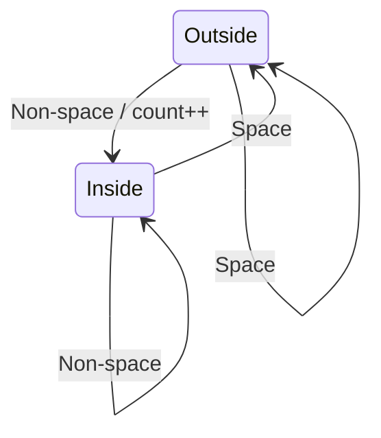
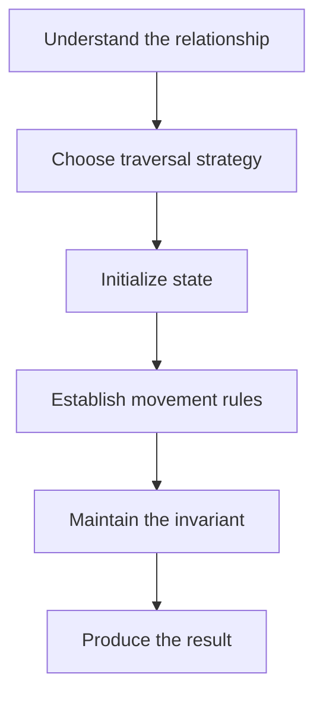

# JavaScript Advanced Loop Applications

**Previous:** [Loop Problem-Solving Patterns](javascript-loop-problem-solving-patterns.md)  
**Current:** Advanced Loop Applications  
**Next:** Loop-Based Algorithms and Practical Challenges

## Table of contents

1. Understanding advanced loop applications
2. Two-pointer traversal
3. Opposite-direction pointers
4. Same-direction pointers
5. Fixed-size sliding window
6. Variable-size sliding window
7. Circular traversal
8. Partitioning
9. Sequence analysis
10. Grouping consecutive elements
11. Prefix sums
12. Advanced state management
13. Loop optimization
14. Problem-solving methodology
15. Practice exercises with answers and explanations
16. Final mental models

---

# 1. Understanding advanced loop applications

## 1.1 What makes a loop application advanced?

An advanced loop application does not necessarily involve complicated loop syntax. It involves controlling how elements are visited, how information is remembered and how previous computations are reused.

```js
const numbers = [2, 4, 6, 8, 10, 12];
```

A basic traversal visits every element from beginning to end. An advanced traversal might:

- Visit elements from both ends simultaneously.
- Maintain a moving group of elements.
- Return to the beginning after reaching the end.
- Rearrange elements according to a condition.
- Reuse previous calculations instead of repeating them.
- Maintain relationships between multiple positions.

## 1.2 Different traversal strategies

| Strategy | Example (bold indicates active values) | Description |
|---|---|---|
| Linear | 2, 4, **6**, 8, 10, 12 | Move one position at a time |
| Two pointers | 2, **4**, 6, 8, **10**, 12 | Maintain two positions simultaneously |
| Sliding window | 2, **4, 6, 8**, 10, 12 | Process a moving group |
| Circular | **2**, 4, 6, 8, 10, **12** | Wrap around the collection |

## 1.3 Fundamental mental model

Instead of asking only: How do I visit every element?

Begin asking: Which elements must I visit, in what order, what relationships exist between them, and what information can I reuse?

# 2. Two-pointer traversal

## 2.1 Understanding pointers

In this context, a pointer is a variable that stores an array index. It is not a low-level memory pointer.

```js
const numbers = [10, 20, 30, 40, 50];
let left = 0;
let right = numbers.length - 1;
```

| Index | 0 | 1 | 2 | 3 | 4 |
|---|---|---|---|---|---|
| Value | 10 | 20 | 30 | 40 | 50 |
| Pointer | left | | | | right |

## 2.2 Expression decomposition

`let left = 0` stores the index of the first element. `numbers.length` returns 5; `numbers.length - 1` becomes `5 - 1`, producing 4, the last index.

```js
numbers[left]  // numbers[0] -> 10
numbers[right] // numbers[4] -> 50
```

The pointers store positions, while array indexing retrieves the values at those positions.

## 2.3 Types of two-pointer traversal

| Type | Movement |
|---|---|
| Opposite direction | Pointers move toward each other |
| Same direction | Both pointers move forward |
| Independent movement | One pointer moves according to a condition |
| Different collections | Each pointer controls a different collection |

## 2.4 Mental model

**Maintain two positions and move them according to the relationship required by the problem.**

# 3. Opposite-direction pointers

## 3.1–3.3 Reversing an array: problem, decomposition and solution

Reverse `[10, 20, 30, 40, 50]` without creating another array. Exchange the first and last elements, then the second and second-last, until the pointers meet or cross.

```js
const numbers = [10, 20, 30, 40, 50];
let left = 0;
let right = numbers.length - 1;
while (left < right) {
  const temp = numbers[left];
  numbers[left] = numbers[right];
  numbers[right] = temp;
  left++;
  right--;
}
console.log(numbers);
// [50, 40, 30, 20, 10]
```

## 3.4 Detailed code and expression breakdown

- `left < right`: initially `0 < 4` is true; at `2 < 2` it is false. The middle element does not need exchanging.
- `const temp = numbers[left]`: becomes `const temp = numbers[0]`, storing 10 before it is overwritten.
- `numbers[left] = numbers[right]`: becomes `numbers[0] = numbers[4]`, then `numbers[0] = 50`. The temporary array is `[50,20,30,40,50]`.
- `numbers[right] = temp`: becomes `numbers[4] = 10`, producing `[50,20,30,40,10]`.
- `left++; right--;`: equivalent here to `left = left + 1; right = right - 1;`. Both pointers move toward the center.

## 3.5–3.6 Reversal tracing

| Left | Right | Values exchanged | Array after exchange |
|---:|---:|---|---|
| 0 | 4 | 10, 50 | `[50,20,30,40,10]` |
| 1 | 3 | 20, 40 | `[50,40,30,20,10]` |
| 2 | 2 | None | Loop terminates |

## 3.7 Why use a while loop?

The termination condition depends on the relationship between two changing variables. A `while` loop expresses this clearly, although a traditional `for` loop could also solve the problem.

## 3.8 Mental model

**Exchange the outermost unprocessed elements, then move inward.**

## 3.9 Checking whether a string is a palindrome

A palindrome reads the same forward and backward, such as `level`, `madam` or `radar`.

```js
const word = "level";
let left = 0;
let right = word.length - 1;
let isPalindrome = true;
while (left < right) {
  if (word[left] !== word[right]) {
    isPalindrome = false;
    break;
  }
  left++;
  right--;
}
console.log(isPalindrome); // true
```

`word[left] !== word[right]` becomes `word[0] !== word[4]`, then `"l" !== "l"`, which is false. Compare l–l and e–e; the middle character needs no comparison. A mismatch sets the flag to false and `break` stops further comparisons. This is an exact, case-sensitive comparison; ignoring punctuation, spaces or case requires additional processing.

**Mental model:** Compare corresponding elements from opposite ends until a mismatch is found or all required comparisons are complete.

## 3.10 Finding a target sum in a sorted array

```js
const numbers = [2, 4, 6, 8, 10, 12];
const target = 18;
let left = 0;
let right = numbers.length - 1;
while (left < right) {
  const sum = numbers[left] + numbers[right];
  if (sum === target) {
    console.log(numbers[left], numbers[right]);
    break;
  } else if (sum < target) {
    left++;
  } else {
    right--;
  }
}
// 6 12
```

Moving left forward increases or preserves the left value; moving right backward decreases or preserves the right value.

| Condition | Meaning | Action |
|---|---|---|
| `sum === target` | Matching pair | Stop |
| `sum < target` | Too small | Move left forward |
| `sum > target` | Too large | Move right backward |

Initially `numbers[left] + numbers[right]` becomes `numbers[0] + numbers[5]`, then `2 + 12 = 14`. Since `14 < 18`, move left forward.

## 3.11 Target-sum trace

| Left | Right | Sum | Action |
|---:|---:|---:|---|
| 0 | 5 | 14 | left++ |
| 1 | 5 | 16 | left++ |
| 2 | 5 | 18 | Stop |

## 3.12 Why must the array be sorted?

Without sorted values, moving a pointer does not reliably increase or decrease the sum. The algorithm could skip a valid pair. Ordering allows unnecessary comparisons to be eliminated.

## 3.13 Comparing with nested loops

| Nested loops | Two pointers |
|---|---|
| Examines possible pairs | Eliminates unnecessary pairs |
| Works with unsorted arrays | Requires sorted input for this algorithm |
| Worst-case O(n²) | O(n) on sorted input |
| Simpler general comparison | Uses ordering to guide movement |

**Mental model:** Use sorted arrangement to determine which pointer should move.

# 4. Same-direction pointers

## 4.1–4.3 Understanding read/write pointers and removing duplicates

Both pointers move forward but perform different responsibilities. The read pointer examines elements; the write pointer determines where accepted elements belong.

```js
const numbers = [1, 1, 2, 2, 3, 3, 4];
let write = 0;
for (let read = 0; read < numbers.length; read++) {
  if (write === 0 || numbers[read] !== numbers[write - 1]) {
    numbers[write] = numbers[read];
    write++;
  }
}
numbers.length = write;
console.log(numbers); // [1, 2, 3, 4]
```

## 4.4 Detailed expression decomposition

`write` is the next destination and the number of accepted elements. `read` is the index being examined.

`write === 0 || numbers[read] !== numbers[write - 1]` accepts the first element automatically or compares the current element with the last accepted one. The logical OR operator short-circuits: if the first condition is true, the second is not evaluated.

When `read = 2` and `write = 1`, the second condition becomes `numbers[2] !== numbers[1 - 1]`, then `numbers[2] !== numbers[0]`, then `2 !== 1`, which is true.

`numbers[write] = numbers[read]` becomes `numbers[1] = numbers[2]`, then `numbers[1] = 2`. Advance `write` only when accepting an element. Finally `numbers.length = write` becomes `numbers.length = 4`, removing elements beyond index 3.

## 4.5–4.6 Read/write execution trace

| Read | Current value | Accepted? | Write after | Accepted portion |
|---:|---:|---|---:|---|
| 0 | 1 | Yes | 1 | `[1]` |
| 1 | 1 | No | 1 | `[1]` |
| 2 | 2 | Yes | 2 | `[1,2]` |
| 3 | 2 | No | 2 | `[1,2]` |
| 4 | 3 | Yes | 3 | `[1,2,3]` |
| 5 | 3 | No | 3 | `[1,2,3]` |
| 6 | 4 | Yes | 4 | `[1,2,3,4]` |

This relies on equal values being grouped together, as in a sorted array.

## 4.7 Mental model

**Read every element, but advance the write position only when an element is accepted.**

# 5. Fixed-size sliding window

## 5.1–5.2 Understanding a window

A window is a continuous group of elements. For `[2,4,6,8,10,12]`, windows of size three are `[2,4,6]`, `[4,6,8]`, `[6,8,10]`, `[8,10,12]`.

Find the largest sum of three consecutive elements in `[2,1,5,1,3,2]`.

| Window | Sum |
|---|---:|
| `[2,1,5]` | 8 |
| `[1,5,1]` | 7 |
| `[5,1,3]` | 9 |
| `[1,3,2]` | 6 |

## 5.3 Basic nested-loop solution

```js
const numbers = [2, 1, 5, 1, 3, 2];
const size = 3;
let maxSum = -Infinity;
for (let i = 0; i <= numbers.length - size; i++) {
  let sum = 0;
  for (let j = i; j < i + size; j++) {
    sum += numbers[j];
  }
  if (sum > maxSum) {
    maxSum = sum;
  }
}
console.log(maxSum); // 9
```

`i <= numbers.length - size` becomes `i <= 6 - 3`, then `i <= 3`, the last valid starting index. `let j = i` starts at the current window. At `i = 2`, `j < i + size` becomes `j < 5`, visiting indexes 2, 3, 4. The problem is that neighboring windows share most elements but their sums are recalculated from scratch.

## 5.4 Sliding window improvement

Previous window `[2,1,5]` has sum 8. Remove 2 and add 1 to obtain `[1,5,1]`: `8 - 2 + 1 = 7`.

## 5.5 Optimized solution

```js
const numbers = [2, 1, 5, 1, 3, 2];
const size = 3;
let windowSum = 0;
// Calculate the first window
for (let i = 0; i < size; i++) {
  windowSum += numbers[i];
}
let maxSum = windowSum;
// Move the window
for (let i = size; i < numbers.length; i++) {
  windowSum += numbers[i];
  windowSum -= numbers[i - size];
  if (windowSum > maxSum) {
    maxSum = windowSum;
  }
}
console.log(maxSum); // 9
```

Assumes size is a positive integer no greater than array length.

## 5.6 Detailed code breakdown

The first loop visits indexes 0–2: `2 + 1 + 5 = 8`. The second loop starts at `i = size`, or 3, the first incoming index. `windowSum += numbers[i]` becomes `8 + numbers[3] = 8 + 1 = 9` temporarily. `i - size` becomes `3 - 3 = 0`, so `windowSum -= numbers[i - size]` becomes `9 - numbers[0] = 9 - 2 = 7`. Compare the completed window sum with `maxSum` and update if larger.

## 5.7–5.8 Sliding window trace

| Incoming | Outgoing | Previous sum | New sum | Maximum |
|---|---|---:|---:|---:|
| Initial window | — | 0 | 8 | 8 |
| 1 | 2 | 8 | 7 | 8 |
| 3 | 1 | 7 | 9 | 9 |
| 2 | 5 | 9 | 6 | 9 |

## 5.9 Mental model

**Maintain a fixed group of elements. When the group moves, remove what leaves and add what enters.**

# 6. Variable-size sliding window

## 6.1–6.3 Understanding variable windows and the problem

A variable-size window expands or shrinks according to a condition. Two pointers represent its boundaries. Find the shortest continuous subarray with sum at least 7 in `[2,1,5,2,3,2]`. Qualifying examples: `[2,1,5]` (8, length 3), `[5,2]` (7, length 2), `[2,3,2]` (7, length 3). Expand until the sum qualifies, then shrink to find a smaller qualifying window.

## 6.4 Solution

```js
const numbers = [2, 1, 5, 2, 3, 2];
const target = 7;
let left = 0;
let windowSum = 0;
let minLength = Infinity;
for (let right = 0; right < numbers.length; right++) {
  windowSum += numbers[right];
  while (windowSum >= target) {
    const length = right - left + 1;
    if (length < minLength) {
      minLength = length;
    }
    windowSum -= numbers[left];
    left++;
  }
}
console.log(minLength === Infinity ? 0 : minLength); // 2
```

## 6.5 Detailed expression decomposition

`windowSum += numbers[right]` expands the window. At right = 2, `[2,1,5]` sums to 8. `while (windowSum >= target)` becomes `while (8 >= 7)`, true.

`right - left + 1` becomes `2 - 0 + 1 = 3`. The +1 includes both boundaries; subtraction alone measures their distance.

`windowSum -= numbers[left]; left++;` removes the leftmost value and advances the boundary. `[2,1,5]` becomes `[1,5]`, sum 6, so shrinking stops.

`Infinity` is larger than every finite length; the first qualifying length replaces it. `minLength === Infinity ? 0 : minLength` returns zero if no window qualified, otherwise the best length.

## 6.6 Variable-window trace

| Operation | Left | Right | Sum | Best length |
|---|---:|---:|---:|---:|
| Add 2 | 0 | 0 | 2 | ∞ |
| Add 1 | 0 | 1 | 3 | ∞ |
| Add 5 | 0 | 2 | 8 | 3 |
| Remove 2 | 1 | 2 | 6 | 3 |
| Add 2 | 1 | 3 | 8 | 3 |
| Remove 1, record length 2 | 2 | 3 | 7 | 2 |
| Remove 5 | 3 | 3 | 2 | 2 |
| Add 3 | 3 | 4 | 5 | 2 |
| Add 2 | 3 | 5 | 7 | 2 |
| Remove 2 | 4 | 5 | 5 | 2 |

## 6.7–6.9 Loop choice, complexity and limitation

The outer `for` expands once per element. The inner `while` shrinks as many times as necessary. Despite nesting, each pointer advances at most n times and never moves backward, so total time is O(n). This sum-based algorithm requires nonnegative numbers and a positive target. Negative numbers invalidate the movement logic because removing a negative value may increase the sum.

## 6.10 Mental model

**Expand to satisfy the condition, shrink to improve the result, and preserve the best qualifying window.**

# 7. Circular traversal

## 7.1–7.3 Understanding circular traversal and repeating a sequence

The end connects to the beginning: `A → B → C → D → E → A`.

```js
const unit = ["A", "B", "C"];
for (let i = 0; i < 8; i++) {
  const position = i % unit.length;
  console.log(unit[position]);
}
// A B C A B C A B (each on its own line)
```

## 7.4 Detailed expression decomposition

`const position = i % unit.length` converts an increasing counter into a repeating valid index. `unit.length` is 3. At i = 4, `4 % 3` is 1, the remainder after division. `unit[position]` becomes `unit[1]`, returning `"B"`.

## 7.5–7.6 Circular indexing trace

| i | i % 3 | Index | Value |
|---:|---:|---:|---|
| 0 | 0 | 0 | A |
| 1 | 1 | 1 | B |
| 2 | 2 | 2 | C |
| 3 | 0 | 0 | A |
| 4 | 1 | 1 | B |
| 5 | 2 | 2 | C |
| 6 | 0 | 0 | A |
| 7 | 1 | 1 | B |

For five elements, the same rule yields indexes 0,1,2,3,4,0,1,...

## 7.7 Starting from an arbitrary position

```js
const letters = ["A", "B", "C", "D", "E"];
const start = 3;
for (let i = 0; i < letters.length; i++) {
  const position = (start + i) % letters.length;
  console.log(letters[position]);
}
// D E A B C
```

At i = 2, `(start + i) % letters.length` becomes `(3 + 2) % 5`, then `5 % 5 = 0`.

## 7.8 Backward circular traversal

JavaScript `%` returns a remainder that can be negative: `-1 % 5` is -1, not a normal array index.

```js
const position = ((index % length) + length) % length;
```

For index = -1 and length = 5: `((-1 % 5) + 5) % 5` → `(-1 + 5) % 5` → `4 % 5` → 4. These expressions require a positive collection length.

## 7.9 Mental model

**Convert an unrestricted position into a valid repeating index using the remainder operator.**

# 8. Partitioning

## 8.1–8.4 Partitioning using separate arrays

Partitioning separates elements into groups according to a condition, retaining both matching and nonmatching elements.

```js
const numbers = [7, 2, 9, 4, 1, 6];
const even = [];
const odd = [];
for (const number of numbers) {
  if (number % 2 === 0) {
    even.push(number);
  } else {
    odd.push(number);
  }
}
console.log(even); // [2, 4, 6]
console.log(odd);  // [7, 9, 1]
```

`number % 2 === 0` determines the group. `even.push(number)` stores matches; `odd.push(number)` stores nonmatches. Both groups preserve relative order.

## 8.5 In-place partitioning

```js
const numbers = [7, 2, 9, 4, 1, 6];
let boundary = 0;
for (let i = 0; i < numbers.length; i++) {
  if (numbers[i] % 2 === 0) {
    const temp = numbers[boundary];
    numbers[boundary] = numbers[i];
    numbers[i] = temp;
    boundary++;
  }
}
console.log(numbers); // [2, 4, 6, 7, 1, 9]
```

## 8.6 Understanding the boundary variable

Everything before `boundary` is even. At i = 1, boundary = 0, `numbers[i] % 2 === 0` becomes `2 % 2 === 0`, true. Exchange indexes 0 and 1, yielding `[2,7,9,4,1,6]`. `boundary++` moves the next destination to 1.

## 8.7 Partition trace

| i | Boundary after | Array |
|---:|---:|---|
| 0 | 0 | `[7,2,9,4,1,6]` |
| 1 | 1 | `[2,7,9,4,1,6]` |
| 2 | 1 | `[2,7,9,4,1,6]` |
| 3 | 2 | `[2,4,9,7,1,6]` |
| 4 | 2 | `[2,4,9,7,1,6]` |
| 5 | 3 | `[2,4,6,7,1,9]` |

## 8.8 Comparing approaches

| Separate arrays | In-place |
|---|---|
| Additional collections | Modifies original |
| Preserves order in both groups | May change relative order |
| O(n) additional space | O(1) additional space |
| Easier to understand | Requires boundary management |

## 8.9 Mental model

**Maintain a boundary between groups and place each qualifying element into its appropriate region.**

# 9. Sequence analysis

## 9.1–9.3 Longest increasing consecutive sequence

Sequence analysis examines relationships between consecutive elements to identify trends, repeated values and changes in direction. In `[3,5,7,2,4,6,8,1]`, the increasing runs are `[3,5,7]`, `[2,4,6,8]`, `[1]`. The longest has four elements.

```js
const numbers = [3, 5, 7, 2, 4, 6, 8, 1];
let currentLength = 1;
let longestLength = 1;
for (let i = 1; i < numbers.length; i++) {
  if (numbers[i] > numbers[i - 1]) {
    currentLength++;
  } else {
    currentLength = 1;
  }
  if (currentLength > longestLength) {
    longestLength = currentLength;
  }
}
console.log(longestLength); // 4
```

Assumes nonempty input.

## 9.4 Detailed breakdown

The first element forms a sequence of length one. At i = 2, `numbers[i] > numbers[i - 1]` becomes `numbers[2] > numbers[1]`, then `7 > 5`, true. `currentLength++` extends the run. Reset to one, not zero, because the current element starts a new possible run.

## 9.5 Execution trace

| Previous | Current | Increasing? | Current length | Longest |
|---:|---:|---|---:|---:|
| — | 3 | Initial | 1 | 1 |
| 3 | 5 | Yes | 2 | 2 |
| 5 | 7 | Yes | 3 | 3 |
| 7 | 2 | No | 1 | 3 |
| 2 | 4 | Yes | 2 | 3 |
| 4 | 6 | Yes | 3 | 3 |
| 6 | 8 | Yes | 4 | 4 |
| 8 | 1 | No | 1 | 4 |

## 9.6 Tracking the actual sequence

```js
const numbers = [3, 5, 7, 2, 4, 6, 8, 1];
let currentLength = 1;
let longestLength = 1;
let bestEnd = 0;
for (let i = 1; i < numbers.length; i++) {
  if (numbers[i] > numbers[i - 1]) {
    currentLength++;
  } else {
    currentLength = 1;
  }
  if (currentLength > longestLength) {
    longestLength = currentLength;
    bestEnd = i;
  }
}
const bestStart = bestEnd - longestLength + 1;
const result = [];
for (let i = bestStart; i <= bestEnd; i++) {
  result.push(numbers[i]);
}
console.log(result); // [2, 4, 6, 8]
```

`bestEnd - longestLength + 1` becomes `6 - 4 + 1 = 3`. The best sequence starts at index 3 and ends at index 6.

## 9.7 Mental model

**Compare neighboring elements, extend the current sequence when the relationship holds, restart when it fails and preserve the best sequence.**

# 10. Grouping consecutive elements

## 10.1–10.3 Understanding grouping and solution

Frequency counting of `["A","A","B","B","B","A"]` produces `{A:3,B:3}`. Consecutive grouping produces `[["A","A"],["B","B","B"],["A"]]`.

```js
const numbers = [1, 1, 2, 2, 2, 3, 1, 1];
const groups = [];
let currentGroup = [];
for (const number of numbers) {
  if (
    currentGroup.length === 0 ||
    number === currentGroup[currentGroup.length - 1]
  ) {
    currentGroup.push(number);
  } else {
    groups.push(currentGroup);
    currentGroup = [number];
  }
}
if (currentGroup.length > 0) {
  groups.push(currentGroup);
}
console.log(groups); // [[1,1],[2,2,2],[3],[1,1]]
```

## 10.4 Detailed expression decomposition

`currentGroup[currentGroup.length - 1]` retrieves the last element. For `[2,2,2]`, length is 3, `3 - 1 = 2`, and `currentGroup[2]` is 2. Comparing `number === currentGroup[currentGroup.length - 1]` determines membership. `groups.push(currentGroup)` stores the completed group. `currentGroup = [number]` creates a different array containing the incoming value.

## 10.5 Finalization

The last group has no following element to trigger saving. `if (currentGroup.length > 0) { groups.push(currentGroup); }` saves it after traversal. This is called finalization.

## 10.6 Grouping visualization

`[1,1] | [2,2,2] | [3] | [1,1]` → `[[1,1],[2,2,2],[3],[1,1]]`.

Equal values separated by other values belong to different groups.

## 10.7 Mental model

**Keep building the current group until its defining relationship changes, save it and begin a new group. Remember to save the final group.**

# 11. Prefix sums

## 11.1–11.2 Understanding and building prefix sums

A prefix sum represents the sum of elements from the beginning up to a particular boundary. It allows range sums without repeatedly traversing those ranges.

```js
const numbers = [10, 20, 30, 40, 50];
const prefix = [0];
for (let i = 0; i < numbers.length; i++) {
  prefix.push(prefix[i] + numbers[i]);
}
console.log(prefix); // [0, 10, 30, 60, 100, 150]
```

## 11.3 Expression decomposition

At i = 2, `prefix.push(prefix[i] + numbers[i])` becomes `prefix.push(prefix[2] + numbers[2])`, then `prefix.push(30 + 30)`, then `prefix.push(60)`.

## 11.4 Execution trace

| i | Current number | Previous prefix | New prefix |
|---:|---:|---:|---:|
| 0 | 10 | 0 | 10 |
| 1 | 20 | 10 | 30 |
| 2 | 30 | 30 | 60 |
| 3 | 40 | 60 | 100 |
| 4 | 50 | 100 | 150 |

## 11.5 Calculating a range sum

```js
const left = 1;
const right = 3;
const rangeSum = prefix[right + 1] - prefix[left];
console.log(rangeSum); // 90
```

`prefix[right + 1] - prefix[left]` becomes `prefix[3 + 1] - prefix[1]`, then `prefix[4] - prefix[1]`, then `100 - 10 = 90`. The larger prefix contains everything through the right boundary; subtracting the earlier prefix removes everything before the left boundary.

## 11.6 Prefix sum explorer (static examples)

| Left | Right | Calculation | Sum |
|---:|---:|---|---:|
| 1 | 3 | 100 - 10 | 90 |
| 0 | 4 | 150 - 0 | 150 |
| 2 | 2 | 60 - 30 | 30 |

## 11.7 Why include the initial zero?

`prefix[0]` represents the sum of zero elements, so the same formula works when the range starts at index zero, without special cases.

## 11.8 Performance

| Operation | Direct traversal | Prefix sums |
|---|---|---|
| Preparation | None | O(n) |
| One range query | O(k), k = range length | O(1) |
| Additional space | O(1) | O(n) |

Useful for many range queries on an unchanged array.

## 11.9 Mental model

**Store accumulated results in advance, then subtract two stored results to isolate a desired range.**

# 12. Advanced state management

## 12.1–12.4 Count words without split()

State determines how an incoming element should be interpreted based on previous iterations. Define a word as a continuous sequence of non-space characters. Two states: outside a word and inside a word. A non-space encountered while outside begins a new word.

```js
const text = "  JavaScript   loops are fun  ";
let count = 0;
let insideWord = false;
for (const char of text) {
  if (char === " ") {
    insideWord = false;
  } else if (!insideWord) {
    count++;
    insideWord = true;
  }
}
console.log(count); // 4
```



## 12.5 Detailed expression decomposition

`insideWord = false` means outside a word. `char === " "` checks for a literal space and resets the state. `!insideWord` reverses the boolean: `!false` is true, `!true` is false. The `else if` runs only for non-space characters while outside a word. `count++` counts a new word, and `insideWord = true` prevents subsequent letters from being counted again.

## 12.6 Execution trace for `" JS  loop"`

| Character | State before | State after | Count |
|---|---|---|---:|
| Space | Outside | Outside | 0 |
| J | Outside | Inside | 1 |
| S | Inside | Inside | 1 |
| Space | Inside | Outside | 1 |
| Space | Outside | Outside | 1 |
| l | Outside | Inside | 2 |
| o | Inside | Inside | 2 |
| o | Inside | Inside | 2 |
| p | Inside | Inside | 2 |

## 12.7 Mental model

**Remember the current state and perform an operation when an incoming element causes a meaningful state transition.**

# 13. Loop optimization

## 13.1–13.3 Avoiding repeated calculations

Optimization reduces unnecessary work while preserving correctness, not simply reducing lines of code. For n elements and window size k, recalculating windows requires `(n-k+1)*k` additions. Sliding windows require `k+2*(n-k)` additions and subtractions. These count sum updates, not every JavaScript operation.

| n | k | Recalculate | Sliding |
|---:|---:|---:|---:|
| 100 | 10 | 910 | 190 |
| 100 | 1 | 100 | 199 |
| 100 | 100 | 100 | 100 |
| 1000 | 10 | 9910 | 1990 |

## 13.4 Early termination

```js
let found = false;
for (const number of numbers) {
  if (number === target) {
    found = true;
  }
}
```

This produces the correct boolean but continues examining unnecessary elements. Improved:

```js
let found = false;
for (const number of numbers) {
  if (number === target) {
    found = true;
    break;
  }
}
```

Once the required information is established, stop.

## 13.5 Combining traversals

```js
let total = 0;
let largest = numbers[0];
for (const number of numbers) {
  total += number;
}
for (const number of numbers) {
  if (number > largest) {
    largest = number;
  }
}
```

Both operations can occur in one traversal:

```js
let total = 0;
let largest = numbers[0];
for (const number of numbers) {
  total += number;
  if (number > largest) {
    largest = number;
  }
}
```

Both have O(n) time complexity, but the second traverses once.

## 13.6 Common time complexities

| Complexity | Typical example |
|---|---|
| O(1) | Access an array element |
| O(log n) | Repeatedly halve a search region |
| O(n) | Traverse once |
| O(n²) | Compare every possible pair |
| O(n³) | Three full nested loops of size n |

| n | Linear | Quadratic | logâ‚‚ n |
|---:|---:|---:|---:|
| 10 | 10 | 100 | 3.32 |
| 20 | 20 | 400 | 4.32 |
| 30 | 30 | 900 | 4.91 |
| 40 | 40 | 1600 | 5.32 |
| 50 | 50 | 2500 | 5.64 |

## 13.7 Time versus space complexity

Time complexity describes growth in computational work; space complexity describes growth in additional memory. In-place reversal uses a fixed number of variables, so time is O(n) and auxiliary space O(1). Creating another reversed array requires O(n) additional storage.

## 13.8 Mental model

**Avoid repeating work when previous results, ordering, boundaries or established conditions can be reused.**

# 14. Advanced loop problem-solving methodology

## 14.1 Recognizing the appropriate pattern

| Requirement | Pattern |
|---|---|
| Compare opposite ends | Opposite-direction pointers |
| Read and rewrite selected elements | Read/write pointers |
| Fixed-length groups | Fixed sliding window |
| Qualifying continuous range | Variable sliding window, when movement rules are valid |
| Repeat a collection | Circular traversal |
| Separate categories | Partitioning |
| Detect consecutive relationships | Sequence analysis |
| Collect uninterrupted groups | Consecutive grouping |
| Repeated range-sum queries | Prefix sums |
| React to previous events | State management |

## 14.2 Questions before coding

| Question | Purpose |
|---|---|
| What is the required result? | Objective |
| Does it involve positions? | Pointers |
| Consecutive elements? | Windows or sequences |
| Sorted input? | Ordering-guided movement |
| What must remain true? | Invariant |
| What information can be reused? | Avoid repeated calculations |
| When should pointers move? | Movement rules |
| When should processing stop? | Termination |
| What about empty input? | Edge cases |

## 14.3 Understanding invariants

An invariant is a condition that remains true at a specified stage of every iteration. In partitioning, every element before `boundary` is even. In fixed sliding windows, after both updates, `windowSum` equals the current window sum. In maximum tracking, `largest` contains the largest element examined so far. Invariants help reason about correctness.

## 14.4 General mental model



# 15. Practice exercises with answers and explanations

Attempt each exercise independently before reading its solution.

## Exercise 1 — Reverse an array in place

Given `[1,2,3,4,5,6]`, reverse the original without another array or `reverse()`.

**Expected output:** `[6,5,4,3,2,1]`

**Hint:** Maintain pointers at opposite ends and exchange their values.

**Pattern:** Opposite-direction pointers.

```js
const numbers = [1, 2, 3, 4, 5, 6];
let left = 0;
let right = numbers.length - 1;
while (left < right) {
  const temp = numbers[left];
  numbers[left] = numbers[right];
  numbers[right] = temp;
  left++;
  right--;
}
console.log(numbers);
```

**Detailed breakdown:**

- `numbers.length - 1`: six elements have indexes 0 through 5, so right begins at 5.
- `left < right`: continue while pointers have not met or crossed.
- `const temp = numbers[left]`: preserve the left value before overwriting it.
- The two assignments move the right value left and restore the original left value at the right position.
- `left++; right--;`: move inward. Three exchanges reverse the six elements.

## Exercise 2 — Check a palindrome

Determine whether `radar` reads the same forward and backward without reversing it.

**Expected output:** `true`

**Hint:** Compare characters at opposite positions.

**Pattern:** Two pointers and boolean tracking.

```js
const word = "radar";
let left = 0;
let right = word.length - 1;
let isPalindrome = true;
while (left < right) {
  if (word[left] !== word[right]) {
    isPalindrome = false;
    break;
  }
  left++;
  right--;
}
console.log(isPalindrome);
```

**Detailed breakdown:**

- `word[left] !== word[right]`: the first comparison is `"r" !== "r"`, false.
- `isPalindrome = false`: record a mismatch if one occurs.
- `break`: one mismatch proves the string is not a palindrome.
- `left++; right--;`: move toward the middle to examine the next pair.

## Exercise 3 — Find a pair with a target sum

Given sorted `[1,3,5,7,9,11]`, find two distinct elements whose sum is 16.

**Expected output:** `5 11`

**Hint:** Move left when the sum is too small, right when too large.

**Pattern:** Opposite-direction pointers.

```js
const numbers = [1, 3, 5, 7, 9, 11];
const target = 16;
let left = 0;
let right = numbers.length - 1;
while (left < right) {
  const sum = numbers[left] + numbers[right];
  if (sum === target) {
    console.log(numbers[left], numbers[right]);
    break;
  } else if (sum < target) {
    left++;
  } else {
    right--;
  }
}
```

**Detailed breakdown:**

- `numbers[left] + numbers[right]`: initially `1 + 11 = 12`.
- `sum < target`: 12 is less than 16, so move left forward.
- When the sum exceeds target, move right backward.
- `sum === target`: 5 and 11 satisfy the requirement; print and stop.
- The movement rules depend on sorted input.

## Exercise 4 — Remove zero values in place

Given `[0,3,0,5,7,0,9]`, remove zeros while preserving nonzero order.

**Expected output:** `[3,5,7,9]`

**Hint:** Use a read pointer and a write pointer.

**Pattern:** Read/write pointers.

```js
const numbers = [0, 3, 0, 5, 7, 0, 9];
let write = 0;
for (let read = 0; read < numbers.length; read++) {
  if (numbers[read] !== 0) {
    numbers[write] = numbers[read];
    write++;
  }
}
numbers.length = write;
console.log(numbers);
```

**Detailed breakdown:**

- `numbers[read] !== 0`: determine whether the current value should be retained.
- `numbers[write] = numbers[read]`: at read 1 and write 0, copy 3 into index 0.
- `write++`: advance destination only when accepting a value.
- `numbers.length = write`: four accepted elements, so truncate to length four.

## Exercise 5 — Largest sum of four consecutive elements

Given `[3,1,4,2,8,5,1]`, find the largest sum of four consecutive elements.

**Expected output:** `19`

**Hint:** Calculate the first window, then add incoming and subtract outgoing values.

**Pattern:** Fixed-size sliding window.

```js
const numbers = [3, 1, 4, 2, 8, 5, 1];
const size = 4;
let sum = 0;
for (let i = 0; i < size; i++) {
  sum += numbers[i];
}
let largest = sum;
for (let i = size; i < numbers.length; i++) {
  sum += numbers[i];
  sum -= numbers[i - size];
  if (sum > largest) {
    largest = sum;
  }
}
console.log(largest);
```

**Detailed breakdown:**

- `i < size`: first window `3 + 1 + 4 + 2 = 10`.
- `numbers[i]`: at i = 4, incoming value is 8.
- `numbers[i - size]`: at i = 4, outgoing value is `numbers[0]`, or 3.
- New sum is `10 + 8 - 3 = 15`.
- Window sums are 10, 15, 19, 16; maximum is 19.

## Exercise 6 — Shortest qualifying window

Given positive numbers `[1,4,2,6,3,1]`, find the shortest continuous subarray with sum at least 8.

**Expected output:** `2`

**Hint:** Expand until the sum qualifies, then shrink while it qualifies.

**Pattern:** Variable-size sliding window.

```js
const numbers = [1, 4, 2, 6, 3, 1];
const target = 8;
let left = 0;
let sum = 0;
let shortest = Infinity;
for (let right = 0; right < numbers.length; right++) {
  sum += numbers[right];
  while (sum >= target) {
    const length = right - left + 1;
    if (length < shortest) {
      shortest = length;
    }
    sum -= numbers[left];
    left++;
  }
}
console.log(shortest === Infinity ? 0 : shortest);
```

**Detailed breakdown:**

- `sum += numbers[right]`: expand by adding the rightmost value.
- `while (sum >= target)`: improve the result whenever the window qualifies.
- `right - left + 1`: number of elements within inclusive boundaries.
- `sum -= numbers[left]`: remove leftmost element before advancing left.
- `[2,6]` has sum 8 and length 2; no single element reaches 8.

## Exercise 7 — Generate a repeating pattern

Given `["X","Y","Z"]`, generate `XYZXYZXYZX`.

**Expected output:** `XYZXYZXYZX`

**Hint:** Use remainder to convert the counter into a repeating index.

**Pattern:** Circular traversal and string accumulation.

```js
const unit = ["X", "Y", "Z"];
let pattern = "";
for (let i = 0; i < 10; i++) {
  const position = i % unit.length;
  pattern += unit[position];
}
console.log(pattern);
```

**Detailed breakdown:**

- `i % unit.length`: at i = 7, `7 % 3` produces index 1.
- `unit[position]`: retrieves `unit[1]`, or `"Y"`.
- `pattern += unit[position]`: equivalent to `pattern = pattern + unit[position]`. Append the retrieved character. For example, `"XYZXYZX" + "Y"` becomes `"XYZXYZXY"`.
- `i < 10`: generate exactly ten characters.

## Exercise 8 — Separate positive and nonpositive values

Given `[-3,5,0,-2,8,4]`, create two arrays containing positive and nonpositive numbers.

**Expected output:** `[5,8,4]` and `[-3,0,-2]`.

**Hint:** Use two arrays and if...else.

**Pattern:** Partitioning.

```js
const numbers = [-3, 5, 0, -2, 8, 4];
const positive = [];
const nonpositive = [];
for (const number of numbers) {
  if (number > 0) {
    positive.push(number);
  } else {
    nonpositive.push(number);
  }
}
console.log(positive);
console.log(nonpositive);
```

**Detailed breakdown:**

- `number > 0`: only strictly positive numbers qualify.
- `positive.push(number)`: append a matching value.
- `else`: every remaining number is zero or negative for this input.
- `nonpositive.push(number)`: preserve nonmatching elements separately.

## Exercise 9 — Longest decreasing sequence

Given `[9,7,5,8,6,4,2,3]`, find the length of the longest strictly decreasing consecutive sequence.

**Expected output:** `4`

**Hint:** Compare neighbors and reset when the relationship fails.

**Pattern:** Neighbor comparison and sequence tracking.

```js
const numbers = [9, 7, 5, 8, 6, 4, 2, 3];
let current = 1;
let longest = 1;
for (let i = 1; i < numbers.length; i++) {
  if (numbers[i] < numbers[i - 1]) {
    current++;
  } else {
    current = 1;
  }
  if (current > longest) {
    longest = current;
  }
}
console.log(longest);
```

**Detailed breakdown:**

- `numbers[i - 1]`: retrieve the immediate predecessor.
- `numbers[i] < numbers[i - 1]`: check whether decreasing relationship continues.
- `current = 1`: current element begins a new possible sequence.
- `longest = current`: preserve a new record. Longest run is `[8,6,4,2]`.

## Exercise 10 — Compress consecutive characters

Given `AAABBCCCCA`, produce `A3B2C4A1`.

**Expected output:** `A3B2C4A1`

**Hint:** Track current character and consecutive count; save completed groups.

**Pattern:** Consecutive grouping and finalization.

```js
const text = "AAABBCCCCA";
let result = "";
let current = text[0];
let count = 1;
for (let i = 1; i < text.length; i++) {
  if (text[i] === current) {
    count++;
  } else {
    result += current + count;
    current = text[i];
    count = 1;
  }
}
result += current + count;
console.log(result);
```

**Detailed breakdown:**

- `current = text[0]`: initialize first group using first character of this nonempty string.
- `text[i] === current`: check group membership.
- `count++`: extend the group on a match.
- `result += current + count`: because current is a string, `"A" + 3` produces `"A3"`, appended to result.
- `current = text[i]; count = 1;`: start a new group on a different character.
- Final update saves the last group because no following character triggers completion.

## Exercise 11 — Calculate a range sum using prefix sums

Given `[4,8,2,6,10]`, build a prefix array and calculate sum from index 1 through 3.

**Expected output:** `16`

**Hint:** Include initial zero and subtract the prefix before the range from the prefix after it.

**Pattern:** Prefix sums.

```js
const numbers = [4, 8, 2, 6, 10];
const prefix = [0];
for (let i = 0; i < numbers.length; i++) {
  prefix.push(prefix[i] + numbers[i]);
}
const left = 1;
const right = 3;
const sum = prefix[right + 1] - prefix[left];
console.log(sum);
```

**Detailed breakdown:**

- `prefix.push(prefix[i] + numbers[i])`: build `[0,4,12,14,20,30]`.
- `right + 1`: convert inclusive right index into prefix boundary.
- `prefix[right + 1] - prefix[left]`: becomes `prefix[4] - prefix[1]`, then `20 - 4`.
- Final result 16 equals `8 + 2 + 6`.

## Exercise 12 — Count transitions between values

Given `[0,0,1,1,0,1,1,0]`, count changes from one value to another.

**Expected output:** `4`

**Hint:** Compare each element with its immediate predecessor.

**Pattern:** State transitions and counting.

```js
const numbers = [0, 0, 1, 1, 0, 1, 1, 0];
let count = 0;
for (let i = 1; i < numbers.length; i++) {
  if (numbers[i] !== numbers[i - 1]) {
    count++;
  }
}
console.log(count);
```

**Detailed breakdown:**

- `let i = 1`: start at first element with a predecessor.
- `numbers[i] !== numbers[i - 1]`: detect a change between consecutive values.
- `count++`: record one transition whenever values differ.
- Transitions: 0→1, 1→0, 0→1, 1→0.

# 16. Final mental models

## 16.1 Concept summary

| Concept | Mental model |
|---|---|
| Two pointers | Maintain two positions simultaneously |
| Opposite-direction pointers | Process elements from both ends |
| Same-direction pointers | Assign different responsibilities to moving positions |
| Read/write pointers | Read every element and write only accepted elements |
| Fixed sliding window | Remove outgoing values and add incoming values |
| Variable sliding window | Expand to qualify and shrink to improve |
| Circular traversal | Convert increasing positions into repeating indexes |
| Partitioning | Separate elements according to a condition |
| Sequence analysis | Track relationships between consecutive elements |
| Consecutive grouping | Build, complete and restart groups |
| Finalization | Process remaining state after traversal ends |
| Prefix sums | Precompute accumulated results for reuse |
| State management | React to incoming elements according to remembered information |
| Invariant | Preserve a condition throughout traversal |
| Optimization | Eliminate unnecessary work |

## 16.2 Learning progression

Topics covered so far:

- Loop fundamentals
- Traditional for loop
- While and do...while
- For...of and for...in
- Loop control statements
- Nested loops
- Pattern generation
- Multidimensional traversal
- Counting and accumulation
- Searching and filtering
- Transformation
- Minimum and maximum tracking
- Boolean flags
- Frequency counting
- Neighbor comparison
- Consecutive tracking
- Running totals
- Two-pointer traversal
- Fixed-size sliding window
- Variable-size sliding window
- Circular traversal
- Partitioning
- Sequence analysis
- Consecutive grouping
- Prefix sums
- Advanced state management
- Loop optimization

Upcoming topics:

- Loop-based searching algorithms
- Loop-based sorting algorithms
- Mathematical algorithms
- Digit manipulation
- Array rotation and merging
- Matrix algorithms
- Combined practical challenges

## 16.3 Fundamental progression of loop mastery

| Level | Description |
|---|---|
| 1 — Syntax | Understand how loops execute |
| 2 — Traversal | Control which elements are visited |
| 3 — Processing | Count, accumulate, search and transform |
| 4 — Relationships | Compare elements, positions and sequences |
| 5 — State | Preserve and update information across iterations |
| 6 — Strategy | Choose efficient traversal and movement rules |
| 7 — Algorithms | Combine concepts to solve complex problems |

---

**Scope of this lesson:** The examples deliberately use ordinary loops, basic array operations and explicit state variables rather than built-in algorithmic shortcuts. Some examples assume sorted arrays, nonempty inputs or positive numbers, as indicated in their explanations. General-purpose input validation and more advanced algorithms are reserved for subsequent lessons.

**File name:** `javascript-advanced-loop-applications.md`

**Previous:** [JavaScript Loop Problem-Solving Patterns](javascript-loop-problem-solving-patterns.md)

**Next:** JavaScript Loop-Based Algorithms and Practical Challenges — Linear Search, Binary Search, Bubble Sort, Selection Sort, Insertion Sort, Mathematical Algorithms, Digit Manipulation and Matrix Algorithms.
