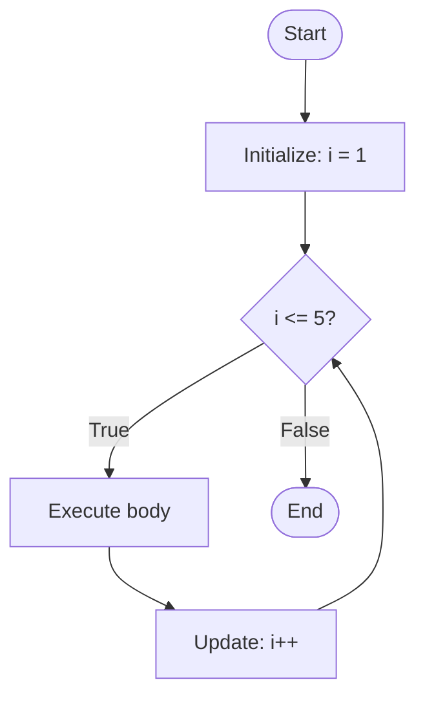

# JavaScript Iteration, Plain Loops, Nested Loops and Deeply Nested Loops

The objective is not just to understand loop syntax but to develop the ability to look at a real-world problem, identify the required iteration logic and implement a solution independently. We will also reproduce JavaScript array methods using plain loops to understand their underlying logic.

## Table of contents

| Part | Topic | Capabilities |
|---|---|---|
| 01 | [Iteration fundamentals](#part-01--iteration-fundamentals) | Repetition and execution flow |
| 02 | Plain loops | `for`, `while`, `do...while`, `for...of`, `for...in` |
| 03 | Conditional iteration | Conditions, selective processing, skipping and termination |
| 04 | Data traversal | Arrays, objects, strings and iterable collections |
| 05 | Data processing | Counting, accumulation, searching, filtering and transformation |
| 06 | Advanced plain loops | Multiple counters, reverse traversal, ranges, steps and state tracking |
| 07 | Array methods using plain loops | Reproducing array method behaviour and comparing implementations |
| 08 | Nested loops | Outer and inner iterations, execution flow and combinations |
| 09 | Nested loop capabilities | Comparisons, grouping, matrices, duplicates and relationships |
| 10 | Deeply nested loops | Three or more levels of iteration and complex data structures |
| 11 | Advanced iteration | Dynamic nesting, recursion, iterators, generators and alternative approaches |
| 12 | Optimization | Time complexity, space complexity and efficient iteration |
| 13 | Integrated problem-solving | Real-world scenarios and mastery exercises |

# Part 01 — Iteration fundamentals

## 1. Understanding iteration

Iteration is the process of repeatedly executing an operation or processing elements in a collection. A **loop** is a programming construct that enables iteration. An **iteration** is one execution of the loop body.

Consider a manufacturing company that needs to inspect five products.

Without a loop:

```javascript
console.log("Inspect product 1");
console.log("Inspect product 2");
console.log("Inspect product 3");
console.log("Inspect product 4");
console.log("Inspect product 5");
```

With a loop:

```javascript
for (let i = 1; i <= 5; i++) {
    console.log(`Inspect product ${i}`);
}
```

**Output**

```text
Inspect product 1
Inspect product 2
Inspect product 3
Inspect product 4
Inspect product 5
```

The loop executes five iterations instead of requiring five separately written instructions.

## 2. Understanding the anatomy of iteration

Most counter-controlled iterations involve five fundamental components.

```javascript
for (let i = 1; i <= 5; i++) {
    console.log(i);
}
```

| Component | Responsibility |
|---|---|
| Initialization | Establishes the starting state |
| Condition | Determines whether to continue |
| Loop body | Performs the required operation |
| Update | Changes the iteration state |
| Termination | Ends repetition when appropriate |

### Code deconstruction

| Syntax | Explanation |
|---|---|
| `for` | JavaScript loop keyword |
| `let` | Declares a reassignable variable |
| `i` | Counter variable |
| `=` | Assignment operator |
| `1` | Initial counter value |
| `;` | Separates loop header clauses |
| `i <= 5` | Continuation condition |
| `<=` | Less than or equal to operator |
| `i++` | Increases `i` by one |
| `{ }` | Encloses the loop body |
| `console.log(i)` | Displays the current counter |

## 3. Understanding the iteration lifecycle



Initialization happens only once. The condition, body and update are repeatedly processed until the condition becomes false.

### Execution demonstration

| Step | Phase | Counter | Condition | Output so far |
|---|---|---:|---|---|
| 1 | Initialization | 1 | Not evaluated | None |
| 2 | Condition check | 1 | true | None |
| 3 | Execute body | 1 | true | 1 |
| 4 | Update counter | 2 | Not re-evaluated | 1 |
| 5 | Condition check | 2 | true | 1 |
| 6 | Execute body | 2 | true | 1, 2 |
| 7 | Update counter | 3 | Not re-evaluated | 1, 2 |
| 8 | Condition check | 3 | true | 1, 2 |
| 9 | Execute body | 3 | true | 1, 2, 3 |
| 10 | Update counter | 4 | Not re-evaluated | 1, 2, 3 |
| 11 | Condition check | 4 | true | 1, 2, 3 |
| 12 | Execute body | 4 | true | 1, 2, 3, 4 |
| 13 | Update counter | 5 | Not re-evaluated | 1, 2, 3, 4 |
| 14 | Condition check | 5 | true | 1, 2, 3, 4 |
| 15 | Execute body | 5 | true | 1, 2, 3, 4, 5 |
| 16 | Update counter | 6 | Not re-evaluated | 1, 2, 3, 4, 5 |
| 17 | Terminate | 6 | false | 1, 2, 3, 4, 5 |

### Execution trace

| Iteration | `i` | `i <= 5` | Output | Updated `i` |
|---|---:|---|---:|---:|
| 1 | 1 | true | 1 | 2 |
| 2 | 2 | true | 2 | 3 |
| 3 | 3 | true | 3 | 4 |
| 4 | 4 | true | 4 | 5 |
| 5 | 5 | true | 5 | 6 |
| Termination | 6 | false | None | None |

## 4. Understanding iteration levels

### Level 1 — Plain loop

```text
[1] [2] [3] [4] [5]
```

One level of repetition — 5 iterations.

### Level 2 — Nested loops

```text
[1,1] [1,2] [1,3] [1,4] [1,5]
[2,1] [2,2] [2,3] [2,4] [2,5]
[3,1] [3,2] [3,3] [3,4] [3,5]
```

Two levels of repetition — 3 × 5 = 15 inner-body executions.

### Level 3 — Deeply nested loops

```text
Group 1       Group 2       Group 3
[1] [2] [3]   [1] [2] [3]   [1] [2] [3]
[4] [5] [6]   [4] [5] [6]   [4] [5] [6]
[7] [8] [9]   [7] [8] [9]   [7] [8] [9]
```

Three levels of repetition — 3 × 3 × 3 = 27 innermost-body executions.

Deeply nested loops are not a separate JavaScript syntax. They are ordinary loops placed inside other loops across multiple levels.

## 5. Fundamental iteration capabilities

| Capability | Purpose |
|---|---|
| Repetition | Perform an operation multiple times |
| Traversal | Visit elements in a collection |
| Counting | Determine the number of elements |
| Accumulation | Build a cumulative result |
| Searching | Locate a particular element |
| Filtering | Select elements meeting conditions |
| Transformation | Convert elements into new values |
| Validation | Verify whether data meets requirements |
| Comparison | Compare multiple values |
| Aggregation | Summarize collections |
| Grouping | Organize elements by shared attributes |
| Partitioning | Divide elements into separate collections |
| Deduplication | Remove repeated values |
| Generation | Generate sequences or combinations |
| Mutation | Modify existing data |
| Sorting | Arrange elements in a particular order |
| Flattening | Convert nested structures into simpler structures |
| State tracking | Maintain information across iterations |
| Relationship matching | Connect related records |
| Simulation | Model repeated processes |

## 6. Practical examples of fundamental iteration

### Example 1 — Repeating an operation

**Real-world question:** A greenhouse has six ventilation fans. Write a program that generates an inspection instruction for each fan.

**Logical decomposition**

1. Start with fan number 1.
2. Continue while the fan number is at most 6.
3. Generate an inspection instruction.
4. Increase the fan number.
5. Stop after the sixth fan.

```javascript
for (let fan = 1; fan <= 6; fan++) {
    console.log(`Inspect ventilation fan ${fan}`);
}
```

**Output**

```text
Inspect ventilation fan 1
Inspect ventilation fan 2
Inspect ventilation fan 3
Inspect ventilation fan 4
Inspect ventilation fan 5
Inspect ventilation fan 6
```

The variable `fan` represents the current item being processed.

### Example 2 — Traversing a collection

**Real-world question:** A botanical research centre maintains an array of plant species. Display every species together with its position in the collection.

```javascript
const plants = [
    "Aloe Vera",
    "Lavender",
    "Rosemary",
    "Basil"
];

for (let i = 0; i < plants.length; i++) {
    console.log(`${i + 1}. ${plants[i]}`);
}
```

**Output**

```text
1. Aloe Vera
2. Lavender
3. Rosemary
4. Basil
```

| Expression | Responsibility |
|---|---|
| `plants` | Array containing plant names |
| `let i = 0` | Starts at the first array index |
| `plants.length` | Returns the array length |
| `i < plants.length` | Prevents traversal beyond the final index |
| `plants[i]` | Accesses the current element |
| `i + 1` | Converts zero-based indexing into human-readable numbering |
| `i++` | Moves to the next index |

### Visualizing array traversal

| Index | Condition: `i < 4` | Current element | Output |
|---:|---|---|---|
| 0 | true | Aloe Vera | 1. Aloe Vera |
| 1 | true | Lavender | 2. Lavender |
| 2 | true | Rosemary | 3. Rosemary |
| 3 | true | Basil | 4. Basil |
| 4 | false | None | No execution |

### Example 3 — Accumulating values

**Real-world question:** An environmental monitoring station records rainfall measurements over five days. Calculate the total rainfall.

```javascript
const rainfall = [12, 8, 15, 0, 20];

let total = 0;

for (let i = 0; i < rainfall.length; i++) {
    total += rainfall[i];
}

console.log(`Total rainfall: ${total} mm`);
```

**Output**

```text
Total rainfall: 55 mm
```

**Logical decomposition:** The problem requires an accumulator that retains its value between iterations.

```javascript
let total = 0;
```

This establishes the accumulator before the loop begins.

```javascript
total += rainfall[i];
```

This is equivalent to:

```javascript
total = total + rainfall[i];
```

### Execution trace

| Iteration | Current rainfall | Previous total | New total |
|---|---:|---:|---:|
| 1 | 12 | 0 | 12 |
| 2 | 8 | 12 | 20 |
| 3 | 15 | 20 | 35 |
| 4 | 0 | 35 | 35 |
| 5 | 20 | 35 | 55 |

### Accumulator growth

```text
Start   0 mm
Day 1  12 mm  ██████
Day 2  20 mm  ██████████
Day 3  35 mm  ██████████████████
Day 4  35 mm  ██████████████████
Day 5  55 mm  ████████████████████████████
```

This pattern forms the foundation of operations such as summation, averages, cumulative totals and certain uses of the `reduce()` array method.

## 7. Understanding iteration direction

Iteration does not always move forward by one.

| Direction | Initialization | Condition | Update |
|---|---|---|---|
| Forward | `i = 0` | `i < 10` | `i++` |
| Backward | `i = 10` | `i >= 0` | `i--` |
| Forward by two | `i = 0` | `i <= 10` | `i += 2` |
| Backward by two | `i = 10` | `i >= 0` | `i -= 2` |
| Multiplicative | `i = 1` | `i <= 100` | `i *= 2` |
| Divisive | `i = 64` | `i >= 1` | `i /= 2` |

### Iteration playground

Change the starting value, ending value and step size in the following examples and run them in a JavaScript console.

```javascript
for (let i = 1; i <= 10; i += 1) {
    console.log(i);
}
```

Output: `1, 2, 3, 4, 5, 6, 7, 8, 9, 10` (one value per line).

```javascript
for (let i = 10; i >= 1; i -= 2) {
    console.log(i);
}
```

Output: `10, 8, 6, 4, 2` (one value per line).

For positive integer step sizes and small integer bounds, the iteration count is `Math.max(0, Math.floor((end - start) / step) + 1)` for forward iteration and `Math.max(0, Math.floor((start - end) / step) + 1)` for backward iteration. If the initial condition is false, no iterations occur.

## 8. Common iteration mistakes

### Off-by-one errors

Incorrect:

```javascript
const colors = ["Red", "Green", "Blue"];

for (let i = 0; i <= colors.length; i++) {
    console.log(colors[i]);
}
```

```text
Red
Green
Blue
undefined
```

The array has three elements, but its valid indices are 0, 1 and 2.

Correct:

```javascript
for (let i = 0; i < colors.length; i++) {
    console.log(colors[i]);
}
```

### Infinite loops

Incorrect (do not run):

```javascript
for (let i = 1; i <= 5; i--) {
    console.log(i);
}
```

The counter moves in the wrong direction, so the condition remains true indefinitely.

Correct:

```javascript
for (let i = 1; i <= 5; i++) {
    console.log(i);
}
```

### Resetting an accumulator inside a loop

Incorrect:

```javascript
const numbers = [10, 20, 30];

for (let i = 0; i < numbers.length; i++) {
    let total = 0;

    total += numbers[i];

    console.log(total);
}
```

```text
10
20
30
```

Correct:

```javascript
const numbers = [10, 20, 30];

let total = 0;

for (let i = 0; i < numbers.length; i++) {
    total += numbers[i];
}

console.log(total);
```

```text
60
```

The accumulator must exist outside the loop if it needs to preserve information across iterations.

## 9. Practice and capability assessment

- [ ] **Basic repetition:** Generate inspection instructions for 15 laboratory instruments.
- [ ] **Forward iteration:** Display every integer from 20 to 40.
- [ ] **Reverse iteration:** Display a countdown from 50 to 0.
- [ ] **Step-controlled iteration:** Generate numbers from 5 to 100 in increments of 5.
- [ ] **Multiplicative iteration:** Generate the sequence 1, 2, 4, 8, 16, 32, 64.
- [ ] **Array traversal:** Display every item in an array of seven book titles.
- [ ] **Indexed traversal:** Display each item together with its position.
- [ ] **Reverse traversal:** Display the elements of an array in reverse order.
- [ ] **Accumulation:** Calculate the total of [15, 25, 40, 10, 30].
- [ ] **Running accumulation:** Display the cumulative total after every iteration.
- [ ] **Execution tracing:** Predict the output of a loop starting at 3, ending at 20 and increasing by 4.
- [ ] **Error identification:** Explain why using `i <= array.length` can produce `undefined`.

## Course progress

- [x] 01. Iteration fundamentals — covered
- [ ] 02. Plain loops
- [ ] 03. Conditional iteration
- [ ] 04. Data traversal
- [ ] 05. Data processing
- [ ] 06. Advanced plain loops
- [ ] 07. Array methods using plain loops
- [ ] 08. Nested loops
- [ ] 09. Nested loop capabilities
- [ ] 10. Deeply nested loops
- [ ] 11. Advanced iteration
- [ ] 12. Optimization
- [ ] 13. Integrated problem-solving

---

[Back to table of contents](#table-of-contents) | Previous: None | Next: Part 02 — Plain Loops (not yet written)

**Up next:** Comprehensive coverage of `for`, `while`, `do...while`, `for...of` and `for...in`, including syntax, execution behaviour, variations, appropriate use cases, limitations, edge cases and multiple practical examples.
